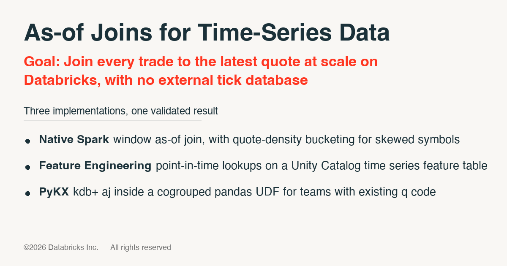

## As-of Joins for Time-Series Data



**Pitch deck:** none yet; this is a code-first offering, start with the notebooks below.

> **SSA offering — how to engage:** If you are interested in this SSA Offering, follow the ASQ process (go/gethelp): Product Help > Pilot/Production Advisory; then put the tag #ssa-offering #asof in both the **Title** and **Description** fields.

**GOAL:** Join every trade to the latest quote at scale on Databricks, with no external tick database.

### Overview
An *as-of join* attaches to each row of one table (trades) the most recent row of another (quotes) with the same key whose timestamp is at or before it. It is the `aj` of kdb+, the `ASOF JOIN` of some warehouses, and the question capital-markets customers ask first when they evaluate Databricks for tick data: "can you do this on billions of rows, and how fast?"

This folder holds three working implementations, all parameterised by Unity Catalog table names and runnable on a synthetic dataset the first notebook generates, plus a reconciliation notebook that proves they agree row for row.

| Notebook | Approach | When to use it |
|---|---|---|
| [`00_generate_sample_data.py`](00_generate_sample_data.py) | Synthetic trades and quotes with one deliberately skewed symbol | No vendor feed at hand, or a reproducible benchmark is needed |
| [`01_native_spark_asof_join.py`](01_native_spark_asof_join.py) | Spark window functions; one window per symbol, or per `(symbol, bucket)` for skewed symbols | Default. Any compute including serverless, no extra packages, fully transparent logic |
| [`02_feature_engineering_point_in_time.py`](02_feature_engineering_point_in_time.py) | Quotes as a time series feature table, point-in-time lookup via `create_training_set` | Zero join code, lineage in Unity Catalog, same table serves training and online lookups |
| [`03_pykx_asof_join.py`](03_pykx_asof_join.py) | kdb+ `aj` executed by PyKX inside a cogrouped pandas UDF | The customer's as-of logic already exists in q and must run unchanged |
| [`04_compare_asof_results.py`](04_compare_asof_results.py) | Row counts, symmetric difference and side-by-side mismatches for any two result tables | Validate an approach, or reconcile against a Snowflake / kdb+ export |

The join logic of the native approach lives in [`asof_spark.py`](asof_spark.py) and is unit-tested on a local SparkSession in [`tests/`](tests/).

### What the native approach does
1. **Union** quotes and trades into one stream per symbol with an indicator column, quotes sorting before trades at equal timestamps so a quote stamped at the trade's instant is visible (kdb+ `aj` semantics; `allow_equal_time=False` gives strictly-earlier).
2. **Window** `partitionBy(sym).orderBy(time, indicator)` and take `last(quote value, ignorenulls)` over the unbounded preceding frame.
3. **Keep** the trade rows.

For skewed symbols (tens of millions of quotes for a few names) the single per-symbol window becomes the long pole. `bucket_by_quote_density` splits every symbol into `num_buckets` time ranges of equal quote count with `ntile`, assigns each trade to the range containing it with a range join, and the window runs over `(sym, bucket)`. Every bucket starts at a quote, so the answer is identical to the single window; only the window sizes change. Bucketing is a one-off sort of the quotes that is worth persisting (clustered on `sym, time, bucket`) when the same quotes are joined repeatedly.

### Expected input schema
| Table | Columns |
|---|---|
| trades | `sym STRING, time TIMESTAMP, price DOUBLE, size BIGINT` (any extra columns pass through) |
| quotes | `sym STRING, time TIMESTAMP, ask DOUBLE, asize BIGINT, bid DOUBLE, bsize BIGINT` |

Both tables should be liquid-clustered on `(sym, time)`; the generator does this, and every approach prunes on those two columns. Column names are parameters in `asof_spark.py`; the notebooks use the names above.

### Quickstart
1. Clone this repository into a Databricks Git folder and open `data-engineering/asof`.
2. Run `00_generate_sample_data` (defaults write to `main.asof_demo`; change the `catalog` / `schema` widgets).
3. Run `01_native_spark_asof_join`; both scenarios write a result table and the last cell shows they agree.
4. Optionally run `02_feature_engineering_point_in_time` and `03_pykx_asof_join` against the same tables.
5. Run `04_compare_asof_results` with any two result tables to reconcile them.

Locally:
```bash
python3 -m venv .venv && source .venv/bin/activate
pip install "pyspark==3.5.*" pytest
pytest tests/ -q
```

### Lessons from the reference runs
- **Liquid clustering on `(sym, time)` matters for every approach.** It is what lets the point-in-time lookup, the window sort and the PyKX cogroup read only the files they need.
- **`use_spark_native_join=True`** on `create_training_set` was the faster Feature Engineering path on large tables.
- **Reconciling against another engine fails on two things first:** timestamp precision (truncate both sides to the millisecond) and time zone (exports written as wall-clock time need `to_utc_timestamp`). Notebook 04 handles both.
- **PyKX** needs a kdb+ license readable by every worker (keep it in a Unity Catalog volume, never in the repo), classic compute, and a pandas return schema that matches the trade columns plus the quote columns `aj` adds.

### GTM Signals — When to Engage
- Capital-markets or any tick / sensor data customer asking whether Databricks can replace or complement kdb+ for as-of joins
- Competitive evaluation against a warehouse `ASOF JOIN` (Snowflake, ClickHouse) on tens of billions of rows
- A q / kdb+ team that wants to keep its logic while moving storage and orchestration to the lakehouse
- Feature engineering for trading or risk models where point-in-time correctness is a hard requirement

### Technical Readiness Criteria
- Unity Catalog workspace; Feature Engineering requires it, the other approaches benefit from it
- Trades and quotes (or equivalent event / state tables) in Delta with a key and an event-time column
- For the PyKX path: a kdb+ license and permission to install `pykx` on classic compute

### Engagement Process (3-Step Joint Execution Plan)

**Step 1 — Discovery and data layout** (4 hrs FTE / 1 wk)
- Preparation: customer shares table sizes, quotes-per-symbol distribution and the as-of semantics they need (equal-time handling, tolerance windows)
- Session: pick the approach(es) to run, agree the validation dataset and success criteria
- Next Steps: SSA adapts the widgets / schema to the customer's tables

**Step 2 — Run and validate** (8 hrs FTE / 1 wk)
- Preparation: tables clustered on `(key, time)`; license in a volume if PyKX is in scope
- Session: run notebooks 01 to 03 on the customer's data, reconcile with 04 against their current engine
- Next Steps: capture timings and cost per approach

**Step 3 — Readout** (2 hrs FTE)
- Session: results, recommended approach, operating model (jobs, serverless vs classic, feature table lifecycle)
- Next Steps: hand-off to the account team for production design

### Customer Requirements
- A technical owner with access to the tick data and knowledge of the expected as-of semantics
- Workspace with Unity Catalog and permission to create schemas and tables in a sandbox catalog

### Dependencies
Databricks Runtime provides `pyspark`, `pandas` and `pyarrow`. Installed by the notebooks that use them: `databricks-feature-engineering` (notebook 02), `pykx==3.1.5` with `pytz` and `toml` (notebook 03). Local tests: `pyspark==3.5.*`, `pytest` (see [`requirements.txt`](requirements.txt)).

### Owners
- Primary: akshay.amin@databricks.com
- Secondary: TBD

### License
Provided under the Databricks License (see the repository's `LICENSE.md`). Third-party libraries: pyspark (Apache-2.0), pandas (BSD-3-Clause), pyarrow (Apache-2.0), pykx (Apache-2.0; running q code additionally requires a kdb+ license from KX), databricks-feature-engineering (Databricks License).
