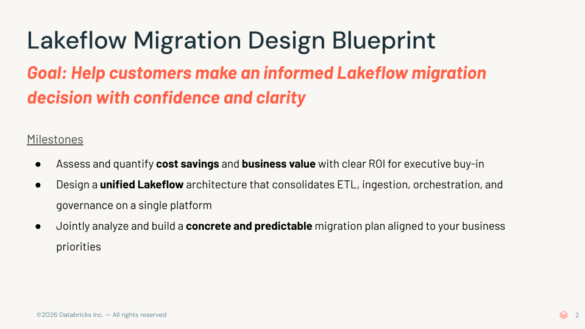

## Lakeflow Migration Design Blueprint

**Pitch deck:** [open in Google Slides](https://docs.google.com/presentation/d/1RfpP10BKuY1zRgpzOHHLI1eZTuyYmDyNh1DF59LiY8o/edit?usp=sharing)

> **SSA offering — how to engage:** If you are interested in this SSA Offering, follow the ASQ process (go/gethelp): Product Help > Pilot/Production Advisory; then put the tag #ssa-offering #lakeflow-migration-design-blueprint in both the **Title** and **Description** fields.

**GOAL:** Help customers make an informed Lakeflow migration decision with confidence and clarity

### Overview
The Lakeflow Migration Design Blueprint is a comprehensive engagement that guides customers through evaluating, designing, and planning a migration of their data engineering workloads to Databricks. Through a series of discovery, architecture design and working sessions, specialists help customers define a target Lakeflow architecture, validate it through an optional joint pilot, and create an actionable migration plan.

### Key Milestones
- **Assess and quantify** cost savings and business value with clear ROI for executive buy-in
- **Design** a unified Lakeflow architecture that consolidates ETL, ingestion, orchestration, and governance on a single platform
- **Jointly analyze and build** a concrete and predictable migration plan aligned to business priorities

### GTM Signals — When to Engage
- Customer must migrate to cloud from the on-prem system (Informatica, Hadoop, etc)
- Customer must unify and modernize DE platform from EMR, ADF, SSIS, Alteryx etc
- UCO with >$60K ARR
- Ready for joint design and planning sessions
- Customer saying “We need a clear understanding on what the migration to Databricks looks like”, "Can Databricks replace our orchestration/ingestion framework?”, "We are spending too much on Hadoop/Informatica/Alteryx"

### Technical Readiness Criteria
- Ready for in-person or virtual design and planning sessions
- Approved to install and run Profiler/Analyzer + migration tools
- Databricks workspace available (or can be provisioned)
- Technical resource with full knowledge of current DE system design and functionality
- Infra/cloud, engineering & security teams available and can provision data source access

### Engagement Process (5-Step Joint Execution Plan)

**Step 1 — Discovery & Assessment** (16hrs FTE / 2 wks)
- Preparation: SA complete L200 enablement and sends discovery questionnaire, tools & instructions. Customer shares current architecture, tool inventory, job schedules
- Two 2 Hour Sessions: Q&A and kick off profiler & analyzer run; Current architecture and ecosystem walkthrough
- Next Steps: Customer sends profiler & analyzer output. SA sets up call to review and agree on agenda

**Step 2 — Architecture Design & Migration Guidance** (24hrs FTE / 2 wks)
- Preparation: SSA reviews output and current architecture from step1 to draft TCO, current architecture analysis, and an initial draft of target architecture POV
- 1-2 Day Sessions: Jointly design target Lakeflow-based architecture, set migration plan and strategy.
- Next Steps: SSA creates a refined architecture proposal, prescriptive migration guidance & tools, pilot scope and recommendation

**Step 3 — Business Value + Migration Proposal** (6hrs FTE / 1 wk)
- Preparation: SSA finalizes refined future state architecture, migration plan with feature mapping & tooling options. Customer review and socializes refined future state architecture, migration strategy, pilot scope with leadership
- 1 Hour Session: Readout of TCO + business value. Align on future state architecture, migration strategy, and pilot execution plan
- Next Steps: Databricks and customer schedule pilot kick-off with committed resources

**Step 4 — Joint PoC** (80hrs FTE / 4 wks)*
- Preparation: Databricks sends detailed pilot execution plan for customer to review
- 1 Hour Session + 4 Week Sprint: Joint review on pilot execution plan and kick-off pilot.
- Next Steps: Joint execution on pilot. SSA documents findings and revises architecture as hand-off.

**Step 5 — Migration Readiness with Implementation Partner** (4hrs FTE / 3 wks)*
- Preparation: AE shares PS/Partner implementation options; SSA shares Migration Blueprint packet
- 1 Hour Session: Discuss migration options, review high-level estimate of LoE/timeline and execution plan
- Next Steps: AE/SA and customer work with Databricks PS/Partner on detailed scoping and SOW

*Steps 4 and 5 can be executed in parallel. Pilot is optional. Customers are recommended to seek PS or SI partner for Lakeflow migration.

### Customer Requirements
- Executive management approval to proceed
- Dedicated business owner + technical owner responsible for success
- At least one dedicated technical resource with full knowledge of and access to current DE systems
- Approval and ability to use profiler + migration tooling
- Access to Databricks workspace with create cluster entitlement, preferably with Unity Catalog and Serverless enabled
- Infra/cloud team point-of-contact to provision access to necessary data sources and systems
- Third-party integration access (optional, e.g., dbt)
