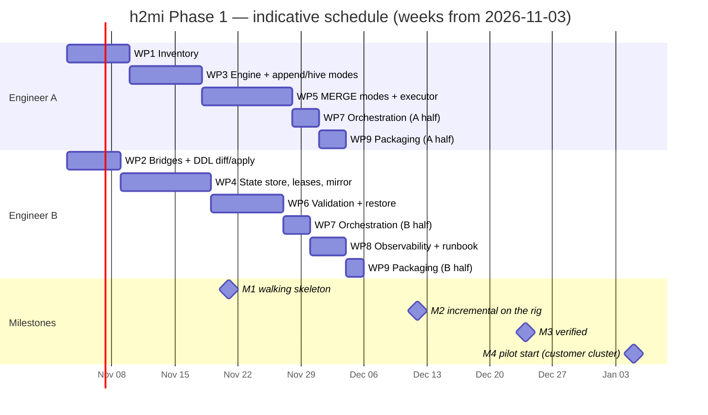

# h2mi — Implementation Plan

**Status:** v0.1 · 2026-10-30 · builds [`technical_design.md`](technical_design.md) v0.2 against
[`requirements.md`](requirements.md) v0.2; flows in [`process_flow.md`](process_flow.md).

## 1. Starting point

| Done (repo state 2026-10-30) | Not started |
|---|---|
| design + requirements, lab-backed on the critical mechanics (IRC auth, > 1 h writes, sync-mode behaviour, partition replace, `REPLACE WHERE`, `observe()`, file-scoped L2, the REPLACE TABLE hazard) | everything that touches a cluster or moves data |
| package skeleton per design §4.1; pure logic implemented and unit-tested (83 tests): config, secrets, type map / classification, DDL generation, planner (modes, apply ladder, batches, executor budget), Spark conf, DESCRIBE parsers, canonical hashing, commit tags | inventory, bridges, DDL diff/apply, engines, the four sync modes, staging, state store, leases, mirror, validation tiers, reconcile, restore, audit context, `doctor` |
| gates: D12 writer lint, secret scan, pre-commit, CI | integration / live / bench suites |

Roughly 10 % of the Phase-1 code exists and none of it has been exercised end to end.

## 2. Assumptions

- Two engineers (A, B) from the FDE team, full time, from **week 1 = 2026-11-03**; one SSA reviewer for design questions.
- An internal EC2 lab rig (HDFS + YARN + Hive 3.1.3 + Spark 4.1 + Iceberg 1.12) and a UC sandbox catalog are available for
  the live suite; the customer's own cluster only from the pilot (M4).
- The customer answers the open questions in `requirements.md` §17 by the dates in §7 below. Where they don't, the plan carries a
  default (noted per item).
- Phase 1 only (`onprem-push`). Phase 2 (`cloud-landing`, `add_files`) is sized in §8 but not scheduled.

## 3. Milestones

| # | Milestone | Means | Target |
|---|---|---|---|
| M0 | Scaffold | this repo, 2026-10-30 | done |
| M1 | **Walking skeleton** | one Hive table and one Iceberg table: `inventory → scan → ddl plan/apply → load` into a local HadoopCatalog target, batch tagged, tier M validated, state in a local Iceberg `h2mi_ctl`; the integration suite runs it in CI | end of week 3 |
| M2 | **Incremental** | all four sync modes with staging + Statement-API MERGE against the UC sandbox from the rig; leases; reconcile-by-tag; HDFS spool → `h2mi_ctl` on the rig's HMS; mirror | end of week 6 |
| M3 | **Verified** | tiered validation (M / scoped L2 async / L2-full), drill-down, restore, audit context + tags, dashboards and alerts on the mirror; L-2, L-3, L-4, L-8, L-9 passed | end of week 8 |
| M4 | **Pilot** | a customer pilot table set through historical load + ≥ 7 incremental cycles with VERIFIED watermarks on the customer's cluster; runbook; hand-over | weeks 9–12 (calendar depends on customer access) |

## 4. Work packages

Each package lists the modules it fills (design §4.1), the IDs it closes, acceptance (what must pass), estimate in
engineer-days (d), and the owner in the two-person split. "DoD" for every package: unit tests for the pure parts,
integration test for the Spark parts, docstring placeholder text removed, requirement status column updated, `make check` clean.

### WP1 — Inventory (A, 7 d) → M1
- **Modules:** `inventory/hms_client.py` (JVM `HiveMetaStoreClient` over py4j with UGI/Kerberos; raw type strings), `inventory/hdfs.py` (recursive listing, per-partition fingerprint: files, bytes, max mtime, size histogram), `inventory/iceberg_meta.py` (snapshots, manifests added in a range, live delete files, spec history), `inventory/inventory.py` (one `inventory_snapshots` row per table + `table_registry`).
- **Closes:** SRC-01, SRC-10, D4, OPS-11 (paged, throttled listing).
- **Acceptance:** on the rig, a table with `timestamp with local time zone` and `uniontype` columns inventories without `CANNOT_RECOGNIZE_HIVE_TYPE`; partition fingerprints are stable across two runs with no change and differ after a file is appended; Iceberg range metadata matches `uc_live_test` expectations.
- **Risk:** py4j access to Hive 3 client classes with Spark 4.1's bundled Hive jars (VER-06). Fallback: a small Java helper on the classpath.

### WP2 — Scanner bridges + DDL diff/apply + spec guard (B, 6 d) → M1
- **Modules:** `scanner/bridges.py` (HQL emitter from REDESIGN findings; `bridges/union_to_struct`), `ddl/diff.py` (DESCRIBE EXTENDED + SHOW TBLPROPERTIES via Statement API → CREATE / NO-OP / ALTER-ADDITIVE / DRIFT; spec guard), `ddl/apply.py` (CREATE, staging, grants, tags, mirror tables; `ddl_events` with SHA-256; `--dry-run`).
- **Closes:** TYP-08, DDL-01..03, DDL-08, DDL-09, DDL-11, DDL-12, DDL-16, INC-13 hook.
- **Acceptance:** `ddl plan` on an existing identical table → NO-OP; on a table with a dropped column → DRIFT (exit 4); `ddl apply` twice is idempotent; the spec guard catches the `overwrite_partitions_probe` REPLACE TABLE case (L-17).
- **Needs:** Statement API access for `ddl-admin`; an answer to Q on custom table properties (DDL-09, default: tags only).

### WP3 — Engine `onprem-push`, append + hive-partition modes (A, 8 d) → M1 / M2
- **Modules:** `engines/onprem_push.py`, `sync/iceberg_append.py`, `sync/hive_partition.py` (HWM, late-data fingerprints, file-delta append, `overwritePartitions`, re-check after write), `sync/projection.py` (finish), `audit/tagging.py` on every commit, `planner/waves.py`.
- **Closes:** INC-02, INC-05..07, INC-09, INC-18 (append_files / partition_replace rungs), INI-02, INI-05, D12.
- **Acceptance:** historical load of a 3-partition Hive table and an Iceberg table into the local target with one tagged commit per batch; a late file in an old partition is picked up by fingerprint and appended; `make lint-writers` stays clean.

### WP4 — State store, leases, spool, mirror (B, 10 d) → M2
- **Modules:** `state/events.py`, `state/store.py` (interface), `state/iceberg_hms_store.py` (append-only tables, derived views `v_cycle_state` / `v_watermark` / `v_verified`, HDFS JSONL spool, one append per run), `state/leases_hdfs.py` (acquire / heartbeat / fence / stale takeover), `state/uc_mirror.py`, `state/maintain.py`, `audit/run_context.py` (UGI principal, OS user, YARN app, scheduler run id, egress IP, versions, `config_hash`).
- **Closes:** ARC-07, D8, OPS-03, OPS-06, AUD-01, AUD-02, INC-10, §7.2 mitigations, R1 plan, R7.
- **Acceptance:** L-9 (two drivers contend for one lease on the rig's HDFS; exactly one wins; stale takeover after TTL); L-8 (control-table commits at target parallelism against the rig's HMS: measure lock wait; go/no-go on D8, fallback = invert D8); mirror append is idempotent (`event_id` dedupe) and a mirror failure never fails a cycle.
- **Needs:** Q-19 (HIVE-26882 lock-free commits) answered; default: locks on.

### WP5 — MERGE modes: upsert, mor, row-value replace, hash-diff; executor routing (A, 10 d) → M2
- **Modules:** `sync/iceberg_upsert.py` (changelog → net per key, materialized), `sync/iceberg_mor.py` (snapshot-diff over touched partitions from range manifests; keyed → MERGE, keyless → row-value replace or partition replace), `sync/staging.py` (tagged append, metadata-only clear by batch, re-MERGE), `sync/hash_diff.py` (bucketed digests, mismatched-bucket exchange, row-value replace on Databricks), Statement-API MERGE / REPLACE WHERE execution with the locality range, `planner/executor.py` wired to `<tgt>.files` bounds, `dbx/client.py` user-agent attribution.
- **Closes:** INC-03, INC-04, INC-08, INC-16, INC-17, INC-18 (remaining rungs), ARC-08 / D11, SEC-10, NFR-11.
- **Acceptance:** L-2 (keyed and keyless MoR sources, clustered and partitioned targets, L0/L1/L2 in sync after each cycle); a kill between staging commit and MERGE is recovered by reconcile; `expected_download_bytes` recorded for every MERGE batch; L-13 pruning measurement on a ~100 GB table (candidate bytes with and without the locality column); L-15 (tag an external MERGE commit; decides whether staging stays a correctness mechanism).
- **Risk:** R2 (snapshot-diff cost on wide unpartitioned tables), R13 (locality). Planner alerts are part of this package.

### WP6 — Validation tiers, drill-down, restore (B, 8 d) → M3
- **Modules:** `validate/fingerprints.py` (tier M from IRC commit metadata; L2-scoped via `_metadata.file_path` / changed keys on DBSQL; L2-full), `validate/compare.py` (VALIDATED / VERIFIED / FAILED; async queue), `validate/drilldown.py` (4096-bucket drill-down, sample to `validation_events`), type-aware checks (VAL-03), `dbx/restore.py` (RESTORE to last VERIFIED, `DESCRIBE HISTORY` cross-check), `state` views for `v_verified`.
- **Closes:** VAL-01..07, VAL-09..13, INC-15, D3, R3, R8.
- **Acceptance:** L-3 canonical hash equality OSS Spark vs DBSQL on a fixture with decimals, floats (±0.0, NaN), NTZ/LTZ timestamps, maps, nested structs; an injected one-row corruption on the target is caught by scoped L2, localized to a bucket, and RESTOREd; L2-full on the pilot historical load.

### WP7 — Orchestration: `sync` / `load` / `reconcile` / `backfill` / `status` / `doctor`, schema drift, CLI, logging (A+B, 6 d) → M3
- **Modules:** `cli.py` (all commands, exit codes, `--dry-run`, `--json`), the reconcile loop (§8.7) over WP4's store, `ddl` drift auto-ALTER for additive changes (§8.9), `util/logging.py` wired with run / table / cycle context, `doctor` preflight (DNS, TLS, token, loadTable, vended-credential S3 HEAD), `h2mi mirror --since`, `h2mi state maintain`.
- **Closes:** INC-11, INC-12, INC-14, OPS-01, OPS-02, OPS-04..07, OPS-10, NFR-04..08, SEC-09, §9.2 taxonomy.
- **Acceptance:** chaos run on the rig: kill the driver at each state transition of a cycle; the next `sync` reconciles to the right state every time (no duplicates, no gaps, L2 in sync); `doctor` fails clearly on a wrong IP allow-list and a missing `EXTERNAL USE SCHEMA`.

### WP8 — Observability and operations (B, 4 d) → M3
- DBSQL dashboard on the mirror (lag vs SLA, failures, backlog partitions, throughput, mirror lag, download bytes), SQL alerts (FAILED, BLOCKED, lag, expired snapshot, non-zero download in an upload-only cycle), `v_audit_attribution` view (L-4 decides `exact` vs `time+ip`), runbook (`docs/runbook.md`: install, configure, onboard a table, read the dashboard, recover from each FAILED / BLOCKED cause).
- **Closes:** OPS-08, OPS-09, AUD-04..09, NFR-10, NFR-11.

### WP9 — Packaging and pilot readiness (A+B, 5 d) → M4
- Wheel + conda-pack `h2mi_env.tar.gz` per tag; `spark-submit` templates for profile A (Spark 4.1) and B (3.5); keytab/principal handling (SEC-08); `secrets/vault.py` for the customer's store (needs the Q answer; default `aws-sm`); scope the IAM / UC grants (DDL-08, SEC-03); handover of the evidence appendix in `docs/`; CODEOWNERS / license / branch protection.
- **Closes:** VER-03, VER-05, SEC-02, SEC-08, NFR-09, §5.1.

### WP10 — Test suites (continuous, both) 
- `tests/integration`: local Spark + Derby HMS + HadoopCatalog fixtures, one per SerDe / type / table shape (Hive partitioned and unpartitioned; Iceberg CoW, MoR, evolved spec); nightly in CI from week 2.
- `tests/live`: the same suites against the UC sandbox from the rig, opt-in, run before every milestone.
- `tests/bench`: L-7 scale (commits / partitions / HMS listing), L-18 hash-diff vs partition replace, L-13 pruning.

## 5. Schedule (two engineers)

Working days only, no holidays modelled; expect M3 to slip into early January in practice. Total ≈ **64 engineer-days**
(≈ 13 engineer-weeks), 8 calendar weeks to M3 with two people. Critical path: WP4 → WP6 → WP7 (state store, then
validation on top of it, then the orchestration that ties them together).

## 6. Test gates per milestone (design §11)

| Milestone | Must pass |
|---|---|
| M1 | unit; integration end-to-end on the local target; L-16 ✅ (observe), L-17 spec guard |
| M2 | L-2 MoR snapshot-diff (keyed / keyless, clustered / partitioned), L-9 leases, L-8 HMS load (go/no-go on D8), L-10 ✅, L-11 ✅, L-14 ✅, L-15 external MERGE tag, L-13 pruning on ~100 GB |
| M3 | L-3 hash determinism, L-4 audit capture, L-7 scale, L-18 hash-diff vs replace, chaos reconcile run |
| M4 | pilot set: historical + ≥ 7 cycles VERIFIED; L-12 credential vending without direct S3 access on the customer's network |

## 7. Decisions needed from the customer (and the default if silent)

| Need by | Question (requirements §17) | Default |
|---|---|---|
| week 2 | secret store product and auth method (`secrets/vault.py`) | AWS Secrets Manager provider; vault stub stays |
| week 2 | scheduler and its run-id environment variable (AUD-01) | Airflow-style `RUN_ID` env var, configurable |
| week 3 | CHAR policy (TYP-05, Q-10) | `preserve_padded` |
| week 4 | HMS lock-free commits available (HIVE-26882, Q-19) | locks on; L-8 decides D8 |
| week 5 | staleness SLA per table class (NFR-01, Q-03) | daily cadence, 24 h SLA |
| week 6 | network path: IP allow-list vs front-end PrivateLink (SEC-05) | allow-list for the pilot |
| week 8 | pilot table set (3–5 tables: one Hive partitioned, one Iceberg CoW keyed, one Iceberg MoR, one keyless, one wide) | chosen from the inventory by size and change pattern |
| before pilot | `ddl-admin` and per-domain `sync` SPs with the DDL-08 / SEC-10 grants; migration YARN queue; keytab | — |

## 8. Out of this plan (Phase 2, sized only)

`cloud-landing` engine + `databricks/cloud_landing_job.py` (≈ 12 d), `add_files` path gated on the ADF-09 benchmark
(≈ 6 d + L-1 bench 3 d), Spark 4.3 / `timestamp_ns` profile when the three VER-04 gates clear (≈ 2 d).

## 9. Risks to the plan itself

| Risk | Effect | Mitigation |
|---|---|---|
| L-8 says the HMS cannot take the control-table load (R1) | WP4 rework: invert D8 (UC primary over IRC, HMS mirror) | the `StateStore` interface is the first thing WP4 builds; both backends implement it |
| py4j access to the Hive 3 metastore client from Spark 4.1 (WP1) | inventory of barrier types blocked | fallback Java helper jar; or `hive --orcfiledump`-style CLI parsing as a last resort |
| customer cluster access for M4 slips | pilot starts late | M1–M3 run entirely on the rig; pilot artifacts (runbook, templates) are ready at M3 |
| hash determinism across engines fails for some type (R3) | L2 false mismatches | exclude the type from L2 and keep L1 for it; documented in `validate.canonical` |
| the FDE team is one engineer | ≈ 13 calendar weeks to M3 | order: WP1 → WP2 → WP3 → WP4 → WP5 → WP6 → WP7 → WP8 → WP9 |

## 10. Working agreements

- Branch per work package (`wp4-state-store`), PR to `main`, CI green, one reviewer; squash merge with the WP id and the
  requirement IDs closed in the message.
- A module leaves placeholder status only with tests and a README status change in the same PR.
- Lab evidence that changes a rule goes to `docs/` first (requirement status, design note), then to code.
- Every probe or benchmark that produces a number records it in the design's §11 table with the date and versions.
