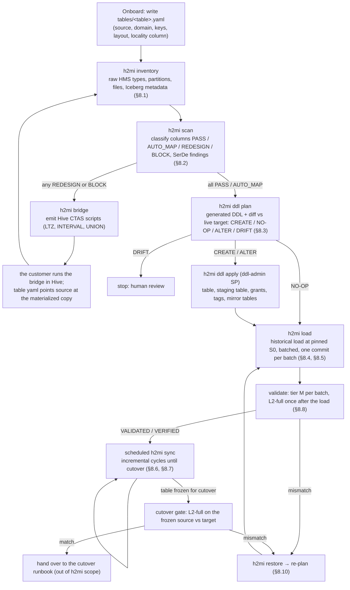
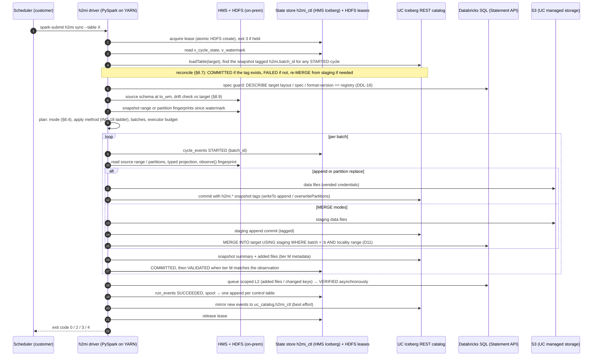
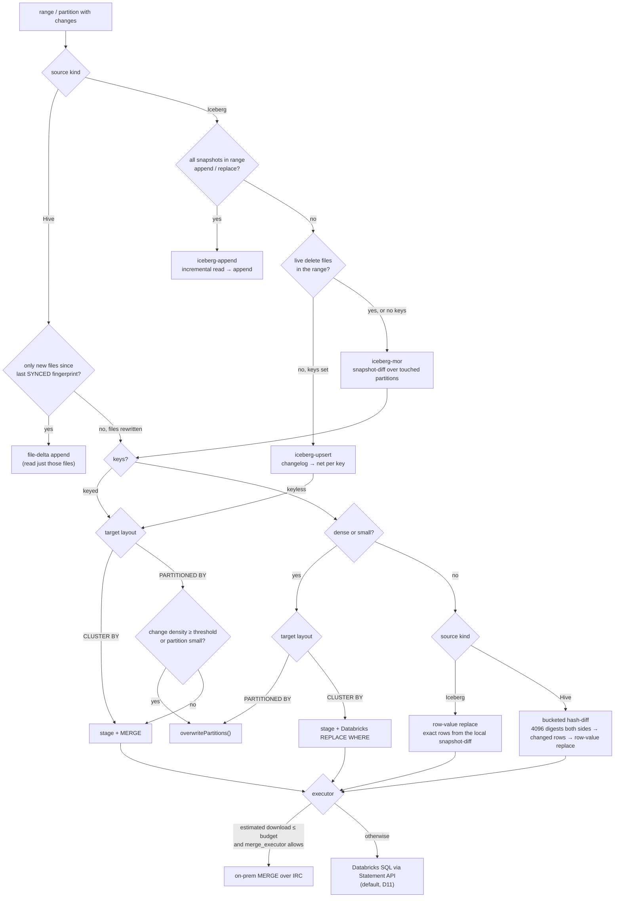
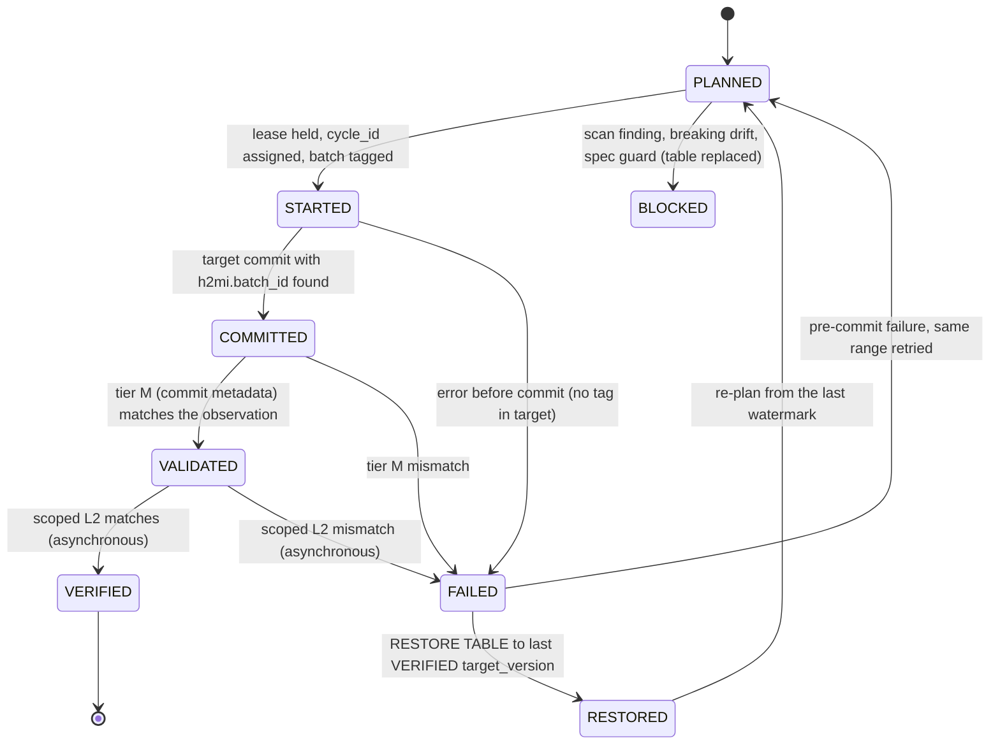
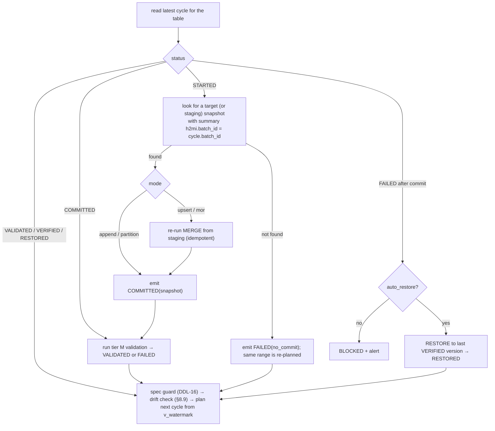
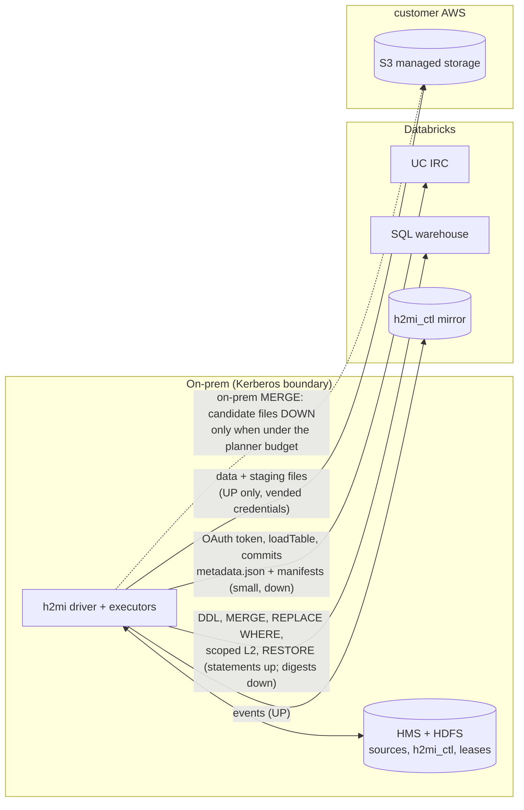

# h2mi — Process Flow

**Status:** v0.1 · 2026-10-30 · companion to [`technical_design.md`](technical_design.md) v0.2 (section numbers below refer to it).

Six views of the same system: the per-table lifecycle, one sync cycle, how a batch is applied, the cycle state machine,
start-up reconciliation, and what crosses the network. Every arrow that crosses the network starts on-prem (D1); data moves
in one direction (D11).

---

## 1. Table lifecycle (onboarding → cutover gate)

---

## 2. One sync cycle (sequence)

---

## 3. Choosing how to apply a batch (planner, §8.4 + §8.6, INC-18)

---

## 4. Cycle state machine (§8.7)

The watermark is the `to_wm` of the highest **VALIDATED** cycle (tier M gates it); `VERIFIED` is the RESTORE point when an
asynchronous L2 later fails.

---

## 5. Start-up reconciliation (every `load` / `sync`, under the lease)

---

## 6. What crosses the network (D1, D11)

Everything solid moves metadata or data **up**. The single dotted path is the only data download, and the planner must
estimate it under `onprem_merge_budget_bytes` before allowing it (§8.4). `expected_download_bytes` is recorded per batch.
