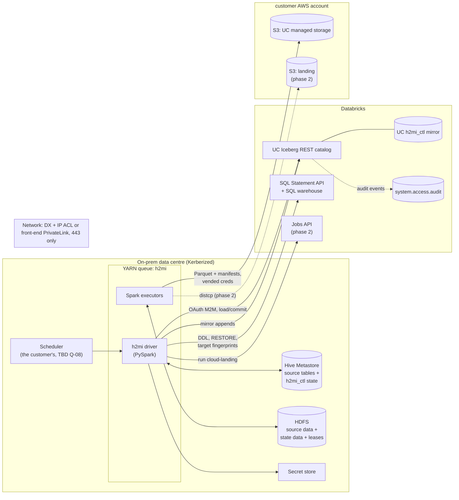
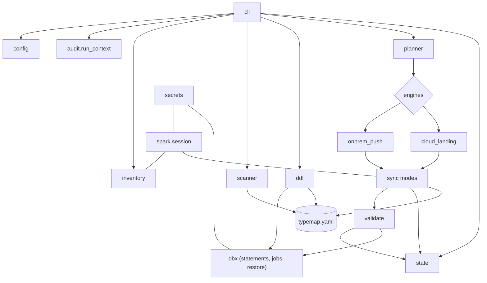
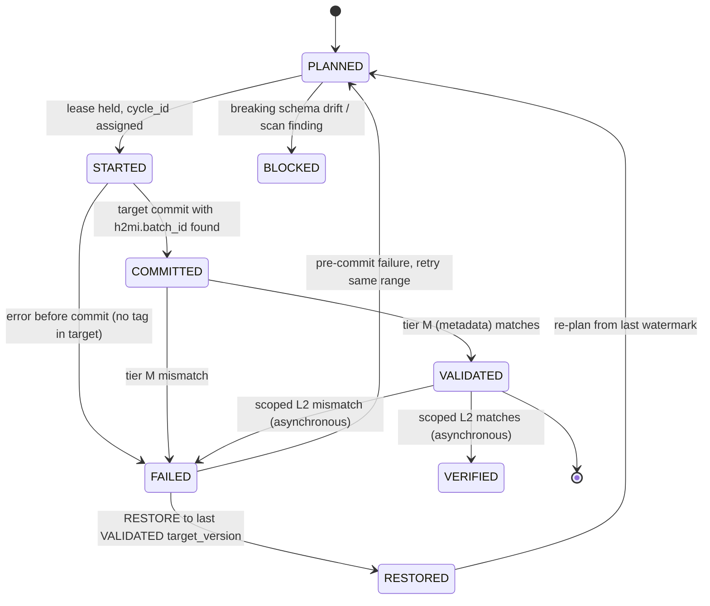

# h2mi — HDFS → UC Managed Iceberg Migration Utility — Technical Design

**Status:** draft v0.2 · 2026-10-30 (v0.1: 2026-10-21; changes listed in §15)
**Implements:** [`requirements.md`](requirements.md) (requirement IDs in brackets, e.g. `[INC-08]`).
**Companions:** [`process_flow.md`](process_flow.md) · [`implementation_plan.md`](implementation_plan.md) (both 2026-10-30; package scaffold landed the same day).

---

## 1. Context, goals, non-goals

`h2mi` moves an on-prem Hadoop estate into Databricks Unity Catalog **managed Iceberg (MI)**. The estate is
HDFS + Hive Metastore (HMS), holding Hive tables and OSS Iceberg tables. The utility does a one-time
historical load, then incremental sync until per-table cutover [SCP-01, SCP-02].

**Goals**
- One tool that inventories, scans, creates targets, loads, syncs, validates, rolls back and audits, table by table.
- Correct by construction: types mapped from one source of truth, idempotent cycles, validated watermarks.
- Operable at PB scale and breadth (thousands of tables × daily partitions) [SCP-12, SCP-13].
- Works with **no inbound connectivity** into the data centre [SCP-10].

**Non-goals** (from [SCP-05]): Glue tables, reverse/exit sync, cutover runbook, managed Delta targets,
federation, migrating HiveQL code/views.

**Phasing** (§14): **Phase 1** = `onprem-push` engine + all shared components. **Phase 2** = `cloud-landing` engine,
plus the `add_files` path if the ADF-09 benchmark says go.

### Decisions recorded in this design

| # | Decision | Why | Req |
|---|---|---|---|
| D1 | **On-prem is the only orchestrator; every call is outbound HTTPS 443.** | No inbound port; the cloud never calls on-prem | SCP-10, SEC-04 |
| D2 | **Commit truth lives in the target** (Iceberg snapshot-summary tags); **workflow truth lives in the state store**; they are reconciled on every start | an Iceberg commit and a state write can't be atomic together | INC-08, OPS-04, OPS-06 |
| D3 | **Hybrid validation:** source fingerprints on on-prem Spark, target fingerprints on a SQL warehouse via the Statement API, compared as digests | no bulk data crosses the network | VAL-07, VAL-09 |
| D4 | **Raw HMS types via the JVM `HiveMetaStoreClient`** (py4j), not Spark's catalog | detect read-barrier types instead of crashing | TYP-08, DT-03, DT-04 |
| D5 | **Type matrix is data** (`typemap.yaml`), shared by the scanner, DDL generator and read projection | all three always agree | TYP-01, TYP-02 |
| D6 | **Two SP roles:** `ddl-admin` (Statement API DDL/GRANT/RESTORE) and per-domain `sync` (IRC data writes, no CREATE) | least privilege, cleaner audit | DDL-08, SEC-03, AUD-07 |
| D7 | **Engines behind one interface**; everything else is shared | build push first, add landing without rework | ARC-03, ARC-04 |
| D8 | **State store = append-only OSS Iceberg tables in the on-prem HMS** (`h2mi_ctl`), **mirrored to UC** | next to the runtime, inside the Kerberos boundary, no new ports; designed around HMS limits (§7.2) | ARC-07 |
| D9 | **Targets are created only through the Statement API**, never IRC `createTable` | full control of TBLPROPERTIES; avoids `catalogManaged` creation-path divergence | DDL-02, DDL-13 |
| D10 | **Python/PySpark package `h2mi`** run with `spark-submit` on YARN; databricks-sdk; PyIceberg (phase 2 only) | matches the lab code; readable by the customer's engineers | — |
| D11 | **On-prem uploads only; every target-side *data* read runs on Databricks.** MERGE / REPLACE WHERE / target fingerprints go through the Statement API; an on-prem MERGE over IRC is allowed only under the planner's download budget (§8.4) | the DX link is the shared, scarce resource of the whole migration; a mis-pruned on-prem MERGE pulls TBs down and delays every other table, while a Databricks MERGE has bounded, predictable cost | SCP-10, INC-03, NFR-03 |
| D12 | **Writers use the DataFrameWriterV2 (`writeTo`) or SQL path only.** `DataFrameWriter.mode("overwrite").saveAsTable` is forbidden | lab 2026-10-30: the V1 path is REPLACE TABLE AS SELECT over IRC; a MODIFY-only SP dropped the target's partition spec and history with it (§7.5, R12) | DDL-13, OPS-03 |

---

## 2. Design principles

1. **Fail closed.** Unknown format, type, mode or schema change → stop the table with a clear finding, never guess [TYP-09, SRC-02].
2. **Idempotent everywhere.** Every command can be re-run with the same outcome [NFR-04].
3. **Source is the source of truth.** The target is rebuilt toward the source, never the reverse [SCP-03].
4. **Single writer per table**, enforced by a lease, not by convention [ARC-06, OPS-03].
5. **Reconcile from durable state.** Every start runs the same reconciliation. There is no "was I restarted?" branch [OPS-06].
6. **Outbound only** [SCP-10]. **Config over code:** onboarding a table is a YAML file [NFR-06].
7. **Never reconcile on IDs.** Snapshot/version IDs are recorded for audit and rollback, never compared across catalogs [VAL-08, SCP-17].
8. **Upload only.** Data crosses the network in one direction. Anything that must read target data (MERGE, slice restates
   on clustered targets, target fingerprints) runs on Databricks compute; the planner must prove a download is small before
   it allows one [D11].

---

## 3. System context



All arrows that cross the network start on-prem [SCP-10]. Executors need S3 egress, not just the driver [SEC-04].

---

## 4. Component architecture



### 4.1 Package layout

```
h2mi/                                        # its own repository
  docs/requirements.md  docs/technical_design.md  pyproject.toml  Makefile
  src/h2mi/
    cli.py                      # entry point: subcommands in §10
    config/      models.py loader.py            # pydantic models, YAML loading, precedence
    secrets/     base.py env.py vault.py aws_sm.py
    spark/       session.py                     # hms + uc catalogs, mandatory conf, runtime secret injection
    inventory/   describe.py hms_client.py hdfs.py iceberg_meta.py inventory.py
    scanner/     typemap.yaml typemap.py classify.py bridges.py
    ddl/         generate.py diff.py apply.py templates/
    planner/     modes.py batches.py executor.py waves.py engine_select.py   # executor = D11 routing + budget
    engines/     base.py onprem_push.py cloud_landing.py
    sync/        projection.py iceberg_append.py iceberg_upsert.py iceberg_mor.py hive_partition.py staging.py
    validate/    canonical.py fingerprints.py compare.py drilldown.py
    state/       events.py store.py iceberg_hms_store.py leases_hdfs.py uc_mirror.py maintain.py
    audit/       run_context.py tagging.py views.sql
    dbx/         client.py statements.py jobs.py restore.py
    util/        retry.py errors.py logging.py
  databricks/    cloud_landing_job.py           # phase 2; imports the same h2mi wheel
  bridges/       union_to_struct/               # Hive GenericUDF source + build script
  conf/examples/ env.yaml  tables/*.yaml
  scripts/       scan_secrets.sh  lint_no_v1_overwrite.py   # pre-commit + CI gates
  tests/         unit/  integration/  live/  bench/
```

### 4.2 Module responsibilities

| Module | Responsibility | Req |
|---|---|---|
| `config` | Load env + table YAML, apply defaults → per-table effective config, validate, compute `config_hash` | NFR-06, NFR-08 |
| `secrets` | Resolve `vault:` / `aws-sm:` / `env:` references at runtime; never logged | SEC-02 |
| `spark.session` | Build the session with `hms` (HiveCatalog) + `uc` (REST) catalogs, mandatory conf (§5.2), inject secrets just before first catalog use | VER-07, DT-02, TYP-05 |
| `inventory` | HMS raw metadata, HDFS listing and file histograms, Iceberg metadata tables | SRC-01, SRC-10 |
| `scanner` | Classify columns PASS / AUTO_MAP / REDESIGN / BLOCK; generate bridge scripts; sub-µs audit | TYP-*, DT-*, SRC-07 |
| `ddl` | Generate DDL from `typemap` + config, diff against live, apply via the Statement API, record events | DDL-* |
| `planner` | Choose sync mode, engine, batches, waves; bandwidth estimate | INC-01, INI-02, INI-05, INI-06, INI-09 |
| `engines` | Execute a `BatchPlan` and return a `CommitResult` | ARC-03, ARC-04 |
| `sync` | Mode algorithms (§8.6); `projection.py` = the single typed-projection builder | INC-*, TYP-02 |
| `validate` | Canonical encoding, fingerprint SQL for both dialects, compare, drill-down | VAL-* |
| `state` | Append-only event store, derived views, HDFS leases, UC mirror, control-table maintenance | ARC-07, OPS-03 |
| `audit` | Capture run context; tag commits; audit-join view | AUD-* |
| `dbx` | databricks-sdk wrapper: statements (polling, retry), jobs, RESTORE | DDL-02, VAL-05 |
| `util` | Retry policies, error taxonomy (§9.2), JSON logging | OPS-04, SEC-09, OPS-10 |

---

## 5. Runtime & deployment

### 5.1 Launch

`h2mi` runs as a PySpark application on the **dedicated migration cluster** (newer stack) [SCP-16] in a dedicated
YARN queue [OPS-02]. One table per application by default (the scheduler fans out). A `--wave` mode can run several
tables in one application with bounded parallelism.

```bash
spark-submit --master yarn --deploy-mode cluster --queue h2mi \
  --principal <svc-principal>@<REALM> --keytab <keytab-path> \
  --archives h2mi_env.tar.gz#env --conf spark.pyspark.python=./env/bin/python \
  --jars iceberg-spark-runtime-4.1_2.13-<iceberg_ver>.jar,iceberg-aws-bundle-<iceberg_ver>.jar \
  --conf spark.sql.extensions=org.apache.iceberg.spark.extensions.IcebergSparkSessionExtensions \
  --files env.yaml,tables/<table>.yaml \
  h2mi_main.py sync --env env.yaml --table tables/<table>.yaml
```

- `<iceberg_ver>` ≥ **1.11.0**, never 1.8.x [VER-01, VER-02]. Profile **A = Spark 4.1 / Scala 2.13 / Java 17**
  (baseline). Profile **B = Spark 3.5 / Scala 2.12** (fallback) [VER-03]. The jars are isolated from production jobs [VER-05].
- The Python env is packaged (venv/conda-pack) with a pinned `h2mi` wheel, `databricks-sdk`, `pydantic`, `pyyaml`.

### 5.2 Mandatory Spark configuration (set by `spark.session`, not by users)

| Setting | Value | Why |
|---|---|---|
| `spark.sql.catalog.hms` | `SparkCatalog`, `type=hive`, `uri=thrift://<hms-host>:9083` | Iceberg sources + `h2mi_ctl` state |
| `spark.sql.catalogImplementation` | `hive` (+ `spark.sql.hive.metastore.version` / `.jars` ≤ 3.1.x) | Hive sources via the session catalog [VER-06] |
| `spark.sql.catalog.uc.*` | `type=rest`, `uri=https://<workspace-host>/api/2.1/unity-catalog/iceberg-rest`, `warehouse=<uc_catalog>`, `rest.auth.type=oauth2`, `oauth2-server-uri=…/oidc/v1/token`, `scope=all-apis`, `io-impl=S3FileIO`, `header.X-Iceberg-Access-Delegation=vended-credentials`, `client.region=<region>` | template from [MA] §3.2 [VER-07] |
| `spark.sql.catalog.uc.credential` | `<client_id>:<secret>`, **set at runtime** from `secrets` before first `uc` access (catalogs initialize lazily) | refreshing OAuth; not in files or CLI [SEC-01, SEC-02] |
| `spark.sql.catalog.uc.token-exchange-enabled` | `false` | Databricks OIDC rejects the default token-exchange refresh, so the OAuth token dies at ~60 min and long jobs fail at commit. Lab 2026-10-22: 70-min write fails without it and passes with it, on 1.11.0 and 1.12.0 [SEC-01, VER-01] |
| `spark.sql.catalog.uc.header.X-H2MI-Run-Id` | `<run_id>` | request-level attribution, 🔵 [AUD-04] |
| `spark.redaction.regex` | default + `\|credential` | hide the secret in the Spark UI (🔵 confirm on the customer's build) |
| `spark.sql.session.timeZone` | `UTC` (recorded) | stable timestamp semantics [DT-02] |
| `spark.sql.readSideCharPadding` | explicit, per the table's CHAR policy (recorded) | [TYP-05] |
| `spark.sql.ansi.enabled` | `true` (Spark 4 default; forced on 3.5 too) | bad casts throw → quarantine, never NULL [VER-08] |
| `spark.sql.sources.partitionOverwriteMode` | `dynamic` | partition restates [INC-05] |
| Iceberg commit retry | `commit.retry.num-retries`, `min/max-wait-ms` tuned for the control tables | HMS contention (§7.2) |

### 5.3 Version matrix and upgrade path

Profile A today. The **Spark 4.3** profile is added once its three gates clear: Spark 4.3 GA; an Iceberg
`iceberg-spark-runtime-4.3`; MI `timestamp_ns` GA [VER-04]. The upgrade is a jar/profile swap. No code uses
`.option("snapshot-id")`; the time-travel helper emits `VERSION AS OF` [VER-05]. `typemap.yaml` carries a
`ns_target` entry that becomes active under the 4.3 profile [DT-06].

---

## 6. Configuration model

Two YAML layers, validated by pydantic. Precedence: **table file > domain defaults > env defaults > built-in defaults**.
The effective config is hashed (`config_hash`) and recorded on every run.

```yaml
# conf/examples/env.yaml
env: prod
databricks:
  host: https://<workspace-host>
  warehouse_id: <warehouse-id>
  uc_catalog: <uc_catalog>
  region: <aws-region>
principals:
  ddl_admin: { client_id: "vault:<path>#client_id", client_secret: "vault:<path>#secret" }
  sync:
    payments: { client_id: "vault:<path>#client_id", client_secret: "vault:<path>#secret" }
source:
  hms_uri: thrift://<hms-host>:9083
  hive_metastore_version: "3.1.3"
state:
  hms_database: h2mi_ctl
  hdfs_root: hdfs://<nameservice>/apps/h2mi
  uc_mirror_schema: h2mi_ctl
naming:
  uc_schema: "{domain}"              # HMS db.table -> <uc_catalog>.<uc_schema>.<uc_table>
  uc_table: "{hive_table}"
defaults:
  engine: onprem-push
  format_version: 3
  char_policy: preserve_padded
  ns_policy: hold
  validation_tier: standard
  batch_target_bytes: 274877906944   # 256 GiB per commit   scan-secrets: allow
  late_data_lookback_partitions: 7
  retention_class: standard
  merge_executor: auto               # auto | databricks | onprem; auto = databricks unless the batch is under budget (§8.4)
  onprem_merge_budget_bytes: 53687091200   # 50 GiB: max estimated download for an on-prem MERGE over IRC
  l2_mode: scoped_async              # tier M gates the watermark; L2 is batch-scoped and asynchronous (§8.8)
  l2_sample_partitions_per_cycle: 2  # standard tier: rotating L2 sample so every partition gets L2 within N cycles
  replace_density_threshold: 0.25    # changed rows / rows in the touched partitions at which partition replace wins (INC-18)
  small_partition_bytes: 1073741824  # below 1 GiB a partition replace beats a hash-diff regardless
retention_classes:
  standard: { log_retention: "interval 30 days", deleted_file_retention: "interval 7 days" }
```

```yaml
# conf/examples/tables/payments.txn_daily.yaml
source: hive_db.txn_daily
domain: payments
target: payments.txn_daily            # optional; else naming rules
mode: auto                            # auto | iceberg-append | iceberg-upsert | iceberg-mor | hive-partition
keys: [txn_id]                        # identifier columns (required for upsert/MERGE)
layout: { cluster_by: [txn_date, txn_id] }       # exactly one of cluster_by | partitioned_by. cluster_by needs keys and
                                                 # leads with the change-locality column (§8.3 layout rules)
locality_column: txn_date                        # bounds the MERGE ON clause and the scoped L2 of each batch (§8.4)
format_version: 2                     # a v2-only reader (Athena) reads this table [DDL-04]
char_policy: trim
column_decisions:
  duration: { redesign: bigint_seconds }        # INTERVAL decision [DT-04]
  event_ts_ns: { ns_policy: accept_truncation } # sign-off recorded [DT-05]
validation_tier: financial            # L0+L1+L2
propagate_partition_drops: false
```

`mode: auto` resolves through the decision table in §8.4. An explicit mode is still checked by the guards (§8.6).

---

## 7. Data model

### 7.1 State store: `h2mi_ctl` (OSS Iceberg v2 in the on-prem HMS)

All tables are **append-only event logs**. Common columns: `event_id STRING` (UUID, the idempotency key for the
mirror), `event_ts TIMESTAMP` (UTC instant), `run_id STRING`, `table_id STRING` (source FQN). Partitioned by
`days(event_ts)`.

```sql
CREATE TABLE hms.h2mi_ctl.run_events (
  event_id STRING, event_ts TIMESTAMP, run_id STRING, command STRING,
  status STRING,                       -- STARTED | SUCCEEDED | FAILED
  env STRING, h2mi_version STRING, config_hash STRING,
  kerberos_principal STRING, real_user STRING, os_user STRING, host STRING,
  yarn_app_id STRING, scheduler_run_id STRING, egress_ip STRING,
  sync_sp STRING, ddl_sp STRING,
  spark_version STRING, iceberg_version STRING, session_tz STRING, char_padding STRING,
  details STRING                       -- JSON
) USING iceberg PARTITIONED BY (days(event_ts));

CREATE TABLE hms.h2mi_ctl.cycle_events (
  event_id STRING, event_ts TIMESTAMP, run_id STRING, table_id STRING,
  cycle_id BIGINT,                     -- monotonic per table, assigned under the lease
  kind STRING,                         -- HISTORICAL | INCREMENTAL | BACKFILL
  mode STRING, engine STRING, batch_id STRING,
  from_wm STRING, to_wm STRING,        -- Iceberg snapshot id, or partition high-water mark for Hive
  partitions ARRAY<STRING>,
  status STRING,                       -- PLANNED | STARTED | COMMITTED | VALIDATED | VERIFIED | FAILED | RESTORED | BLOCKED
  target_snapshot_id BIGINT, target_version BIGINT,
  rows_written BIGINT, bytes_written BIGINT,
  merge_executor STRING,               -- databricks | onprem (MERGE modes only)
  candidate_files BIGINT, candidate_bytes BIGINT, expected_download_bytes BIGINT,   -- planner estimate (§8.4)
  error STRING, details STRING
) USING iceberg PARTITIONED BY (days(event_ts));
```

Other tables, all in the same style:

| Table | Key columns | Purpose |
|---|---|---|
| `table_registry` | table_id, target, domain, engine, mode, config_hash, lifecycle (`ACTIVE`/`PAUSED`/`CUTOVER`) | onboarded tables |
| `inventory_snapshots` | table_id, table_type, input/output format, serde + props, location, partition keys, partitions, files, bytes, `file_size_hist MAP<STRING,BIGINT>`, iceberg format-version, write modes, `has_delete_files`, current snapshot, `raw_schema` (JSON of raw HMS type strings) | [SRC-01] |
| `scan_findings` | table_id, column, hive_type, target_type, class, rule_id, message, decision | [TYP-01] |
| `ddl_events` | table_id, action (`CREATE`/`ALTER`/`GRANT`/`TAG`/`RESTORE`), ddl_sha256, statement_id, actor_sp, status, error | [DDL-12, AUD-09] |
| `partition_events` | table_id, partition_key (`dt=2026-10-01`), fp_files, fp_bytes, fp_max_mtime, cycle_id, status (`SYNCED`/`CHANGED`/`DROPPED`) | Hive HWM + fingerprints [INC-05, INC-06] |
| `validation_events` | table_id, cycle_id, partition_key, level, side (`SRC`/`TGT`), metrics `MAP<STRING,STRING>`, result (`MATCH`/`MISMATCH`), sample | [VAL-10] |
| `file_ledger` | table_id, source_path, size, mtime, target_path, snapshot_id | add_files idempotency, phase 2 [ADF-06] |

Quarantine rows (cast failures) go to `hms.h2mi_quarantine.<table>` (raw values as STRING + error + cycle_id), never into the target [VER-08].

**Derived views (current state):**

```sql
CREATE VIEW hms.h2mi_ctl.v_cycle_state AS
SELECT table_id, cycle_id,
       max_by(status, event_ts)            AS status,
       max_by(target_snapshot_id, event_ts) AS target_snapshot_id,
       max_by(target_version, event_ts)     AS target_version,
       first(from_wm) AS from_wm, first(to_wm) AS to_wm, first(batch_id) AS batch_id, first(mode) AS mode
FROM hms.h2mi_ctl.cycle_events GROUP BY table_id, cycle_id;

-- Watermark = to_wm of the highest VALIDATED cycle (cycle_id ordering; snapshot ids are NOT ordered)
CREATE VIEW hms.h2mi_ctl.v_watermark AS
SELECT table_id, max_by(to_wm, cycle_id) AS watermark, max(cycle_id) AS cycle_id,
       max_by(target_version, cycle_id) AS last_good_target_version
FROM hms.h2mi_ctl.v_cycle_state WHERE status = 'VALIDATED' GROUP BY table_id;
```

`VALIDATED` means tier M passed (§8.8) and is what advances the watermark. `v_verified` (same shape, `status IN
('VALIDATED','VERIFIED')` with the L2 result) gives the RESTORE point when an asynchronous L2 later reports a mismatch.

### 7.2 Why HMS, and how its limits are handled

The state store sits next to the runtime, inside the Kerberos boundary, and needs no new ports [D8]. HMS is not an OLTP
store, so the design compensates:

| Limit | Mitigation |
|---|---|
| Row updates are expensive (CoW rewrites / MoR deletes) | **Append-only events**; current state comes from views. No UPDATE/MERGE on control tables. |
| Every commit takes an HMS lock and writes metadata | Events are **spooled to HDFS (JSONL) during the run and appended once per run per control table** (one commit instead of 4–6 per cycle); a spool left behind by a crash is replayed at the next start. Dedicated `h2mi_ctl` database. Commit-retry tuning. Optional lock-free commits (`engine.hive.lock-enabled=false`) **only** if the customer's HMS includes HIVE-26882 (🔵 Q-19). **Scale test** before production (§11, test L-8). |
| No row locks → no safe leases | Leases are **atomic HDFS files** (§7.3), not table rows. |
| Small files / metadata growth | `h2mi state maintain` (scheduled): `rewrite_data_files`, `expire_snapshots`, `remove_orphan_files`, `rewrite_manifests`. These are on-prem OSS tables, so external maintenance is allowed (unlike MI). |
| Invisible to the cloud | **UC mirror** (§7.4). |
| A state write can be lost after a target commit | Commit truth is in the target's snapshot tags; reconciliation recovers it (§8.7) [D2]. |

### 7.3 Leases (single writer per table)

File: `<hdfs_root>/leases/<table_id>.lock`. The content is JSON:
`{table_id, run_id, host, yarn_app_id, acquired_at, expires_at}`.

```
acquire(table):
  ok = fs.create(lock, overwrite=False)            # atomic on HDFS; exactly one creator wins
  if ok: write lease(expires_at = now + ttl); return OWNED
  cur = read(lock)
  if cur.expires_at + grace < now:                 # stale owner
     if fs.rename(lock, lock + ".stale." + run_id):   # atomic; one contender wins
        return acquire(table)
  return HELD_BY(cur.run_id)                       # exit code 3, the scheduler retries later
heartbeat(): rewrite own lease with a new expires_at (every ttl/3); verify run_id is still ours
fence():     before every target commit -> re-read lock; abort if not ours  [OPS-03]
release():   delete lock (only if still ours)
```

The TTL is greater than the longest expected stall. Clock-skew tolerance is in `grace`. 🔵 test: concurrent acquire/takeover on the customer's HDFS version.

### 7.4 UC mirror and audit join

`ddl-admin` pre-creates identical MI tables in `<uc_catalog>.h2mi_ctl`. At the end of each cycle (and via
`h2mi mirror --since`), the sync SP appends the new events over IRC. Each append is filtered by `event_id NOT IN target`
for the window, so it is idempotent. Mirror lag is shown on the dashboard. A mirror failure never fails a sync cycle
(it is retried at the next run).

```sql
-- in DBSQL, on the mirror [AUD-05]
CREATE VIEW <uc_catalog>.h2mi_ctl.v_audit_attribution AS
SELECT a.event_time, a.service_name, a.action_name, a.source_ip_address, a.user_agent,
       r.run_id, r.kerberos_principal, r.os_user, r.host, r.yarn_app_id, r.scheduler_run_id,
       CASE WHEN a.user_agent LIKE concat('%', r.run_id, '%') THEN 'exact' ELSE 'time+ip' END AS match_quality
FROM system.access.audit a
JOIN <uc_catalog>.h2mi_ctl.v_runs r
  ON a.event_time BETWEEN r.started_at AND coalesce(r.finished_at, current_timestamp())
 AND a.user_identity.email = r.sync_sp           -- 🔵 confirm the SP identity field + IRC service_name
 AND (a.user_agent LIKE concat('%', r.run_id, '%') OR a.source_ip_address = r.egress_ip);
```

When two runs share one SP and one egress IP at the same moment, only the request-level tag (`X-H2MI-Run-Id` / user agent,
🔵) disambiguates them. Otherwise the view reports `time+ip` and can return multiple candidate runs. This is why per-domain SPs
help [AUD-07].

### 7.5 Target storage layout (what managed Iceberg looks like in S3)

Lab 2026-10-30, `CREATE TABLE … USING ICEBERG PARTITIONED BY (dt)` through Databricks SQL, written over IRC:

```
<bucket>/…/__unitystorage/catalogs/<catalog-uuid>/tables/<table-uuid>/
  _delta_log/0000N.json (+ .crc), _delta_log/_staged_commits/…       Delta log, catalog-managed commits
  _iceberg/metadata/0000N-<uuid>.gz.metadata.json, *-m0.avro, snap-*.avro   Iceberg metadata
  0001/0011/0101/01010000/<table-uuid>/_iceberg/dt=2026-10-01/00000-8-….parquet     data files
```

- `write.object-storage.enabled=true`: each data file sits under a hashed 4-level binary prefix; the `dt=…` segment appears
  only inside that prefix. **There is no top-level partition directory tree.** Partition discovery is from manifests only;
  nothing in h2mi may derive partitions from paths on the target.
- Both metadata stacks are maintained by UC. Files dropped by an overwrite or replace stay in S3 until Databricks vacuums
  them; external `remove_orphan_files` / `expire_snapshots` are not available on MI (unlike the on-prem control tables).
- Defaults observed: `format-version=2` (so `format_version` is always explicit in the DDL), `gc.enabled=false`,
  `history.expire.min-snapshots-to-keep=100`, metadata gzip, Parquet zstd.
- A `REPLACE TABLE` arriving over IRC (D12) rewrote `default-spec-id` from the `dt` spec to the unpartitioned spec 0 and
  reset the snapshot list, same `table-uuid`; the Delta log recorded `REPLACE TABLE partitionBy []`, so the earlier Delta
  versions remain restorable within retention [DDL-07].

---

## 8. Pipeline stages

### 8.1 Inventory — `h2mi inventory` [SRC-01, SRC-10]

| Source | How | Notes |
|---|---|---|
| Hive table metadata, **raw type strings** | JVM `org.apache.hadoop.hive.metastore.HiveMetaStoreClient` via py4j (Kerberos via UGI) | Spark's catalog would throw `CANNOT_RECOGNIZE_HIVE_TYPE` on LTZ/UNION/INTERVAL; the raw client returns the strings [D4] |
| Partitions | `listPartitions` (paged, throttled) [OPS-11] | partition key → location |
| Files, bytes, mtime, histogram | Hadoop `FileSystem.listFiles(recursive)` per table/partition location | also the Hive partition fingerprint |
| Iceberg tables | `hms.<db>.<t>.snapshots`, `.files`, `.delete_files`, `.partitions`, `.history` + table properties | `has_delete_files`, format-version, write modes, spec history |

Output: one `inventory_snapshots` row per table, plus `table_registry` for onboarded tables. Inventory is read-only and safe to re-run.

### 8.2 Pre-flight scan and bridges — `h2mi scan`, `h2mi bridge` [TYP-01..09, DT-01..05, SRC-07]

`typemap.yaml` holds one rule per Hive type pattern. Excerpt:

```yaml
- match: "tinyint|smallint"      ; class: AUTO_MAP ; target: INT ; read_cast: "CAST({c} AS INT)"
- match: "decimal"               ; class: AUTO_MAP ; target: "DECIMAL(10,0)" ; finding: "unqualified decimal"
- match: "decimal\\((\\d+),(\\d+)\\)" ; class: PASS ; target: "DECIMAL({1},{2})"
- match: "char\\((\\d+)\\)"      ; class: AUTO_MAP ; target: STRING ; read_cast: "{char_policy}"
- match: "timestamp"             ; class: AUTO_MAP ; target: TIMESTAMP_NTZ ; read_cast: "CAST({c} AS TIMESTAMP_NTZ)"
- match: "timestamp with local time zone" ; class: REDESIGN ; target: TIMESTAMP ; bridge: ltz_ctas
- match: "interval_(year_month|day_time)" ; class: REDESIGN ; requires: column_decisions.redesign ; bridge: interval_ctas
- match: "uniontype<.*>"         ; class: REDESIGN ; target: "STRUCT<tag:INT,...>" ; bridge: union_udf_ctas
- match: "void"                  ; class: AUTO_MAP ; target: STRING ; read_cast: "CAST(NULL AS STRING)"
- match: ".*"                    ; class: BLOCK                              # fail closed [TYP-09]
```

Rules apply recursively inside `array/map/struct` (struct fields are forced nullable [TYP-07]). The scanner also:
- adds **SerDe findings** from the §3.1 matrix of requirements.md (JSON → reparse; Regex/OpenCSV → STRING unless enriched)
  [SRC-03, SRC-04]
- samples files of text tables and flags HMS-vs-file disagreements [SRC-07]
- runs the **sub-µs audit** on timestamp columns that can carry nanoseconds (count of non-zero sub-µs digits) and applies
  `ns_policy` [DT-05]
- writes `scan_findings`. A table with any open REDESIGN/BLOCK finding is **not loadable** (`load`/`sync` exit code 4).

`h2mi bridge` emits Hive-side scripts for REDESIGN columns: materialized CTAS (never a view) for LTZ / INTERVAL, and
`ADD JAR` + `CREATE TEMPORARY FUNCTION union_to_struct` + CTAS for UNION (UDF from `bridges/union_to_struct/`) [TYP-08].
After the customer runs a bridge, the table config points `source` at the materialized table.

### 8.3 DDL — `h2mi ddl plan|apply` [DDL-01..14]

1. **Generate** from the effective config + `typemap` → `CREATE TABLE <uc_catalog>.<schema>.<table> (...) USING ICEBERG`
   with `CLUSTER BY` or `PARTITIONED BY`; TBLPROPERTIES: `'format-version'`, explicit row-tracking/DV state when
   `CLUSTER BY` is used, retention class (`delta.logRetentionDuration`, `delta.deletedFileRetentionDuration`); column
   comments from HMS. Written to `out/ddl/<table>.sql` for review [DDL-01].
2. **Deny-list check:** reject `schema.name-mapping.default`, `delta.enableChangeDataFeed` (v3), `gc.enabled`,
   `history.expire.max-snapshot-age-ms` [DDL-06].
3. **Diff** (`ddl plan`, also the dry-run [DDL-03]): `DESCRIBE TABLE EXTENDED` + `SHOW TBLPROPERTIES` via the Statement API,
   compared with the expected state. Result: `CREATE` / `NO-OP` / `ALTER-ADDITIVE` / `DRIFT` (refuse, report) [DDL-02].
4. **Apply** (`ddl apply`, as `ddl-admin`): CREATE, then the auxiliary objects:
   - `GRANT` (sync SP: USE CATALOG/SCHEMA, SELECT, MODIFY, EXTERNAL USE SCHEMA; readers: SELECT) [DDL-08]
   - owner = group
   - UC tags (source, domain, wave, mode) [DDL-09]
   - the per-table **staging table** `__h2mi_stg_<table>` for upsert/mor modes (same columns + `_h2mi_change` +
     `_h2mi_batch_id`)
   - the mirror tables (once)

   Each statement → `ddl_events` with SHA-256 [DDL-12]. PO is set at catalog/schema level [DDL-10]. Never IRC
   `createTable` [DDL-13].
5. **Namespace mapping** from naming rules, normalized to lowercase. Collisions are detected across the whole registry before any apply [DDL-11].
6. **Layout rules** (exactly one per table): keyed MERGE targets → `CLUSTER BY (<locality column>, <keys…>)` with
   `write.{merge,update,delete}.mode = merge-on-read`; keyless and `hive-partition` targets → `PARTITIONED BY` the source
   slice columns (identity); staging tables → `PARTITIONED BY (_h2mi_batch_id)` so the post-VALIDATED clear is a metadata-only
   partition drop. `CLUSTER BY` on the key alone is a finding, not an option: per-file bounds of a surrogate/UUID key overlap
   every batch, so nothing prunes (R13). Partitioning and liquid clustering cannot be combined.

The Statement API client (`dbx.statements`) uses databricks-sdk `statement_execution.execute_statement`. It polls
until a terminal state, retries IP-ACL 403s with backoff [SEC-09], and sets `user_agent_extra` with `h2mi/<version>` and `run_id` [AUD-04].

### 8.4 Planner — mode, batches, waves, engine [INC-01, INI-02, INI-05, INI-06, INI-09]

**Mode resolution for `mode: auto`:**

| Source | Condition (from inventory + snapshot range) | Mode |
|---|---|---|
| Hive (any SerDe) | — | `hive-partition` (unpartitioned → single partition `__all__`) |
| Iceberg | all snapshots in the range are `append` (or `replace`), **regardless of write mode or live delete files**: delete files only apply to data files written before them (lab 2026-10-22: append read correct on a MoR range where the changelog failed). Checked first. | `iceberg-append` |
| Iceberg | range has `overwrite`/`delete`, **no delete files** added, `keys` set | `iceberg-upsert` |
| Iceberg | range has non-append operations **and any snapshot in it has live delete files** (not just *added* ones: the changelog scan rejects a snapshot whose live delete manifests carry over from earlier UPDATE/DELETE commits; lab 2026-10-22: an insert-only range on a MoR table still failed until compaction), or no `keys` | `iceberg-mor` |
| Historical load (any) | — | full read at the pinned S0 / partition set, batched |

The mode is re-resolved **per cycle** from the actual range, because a MoR table whose range has only appends can use the
append path. A configured mode is a ceiling, never a bypass of the guards.

**Batches:** partitions (Hive or Iceberg partition values at S0) are packed by size into ≈ `batch_target_bytes`.
Each batch is one target commit [INI-02]. **Waves:** tables are grouped by domain/size/priority; the plan reports total
bytes and estimated duration at the configured or measured throughput [INI-05, INI-09].

**Engine selection [INI-06]:** `onprem-push` by default. `cloud-landing` (phase 2) is eligible when the table is large,
the format is landing-readable (Parquet/ORC/Avro/LazySimple/JSON; Regex/OpenCSV via native reparse) and policy allows.
`add_files` (phase 2) applies only when every ADF-01 condition holds and ADF-09 = go.

**MERGE executor and download budget [D11].** For every MERGE batch the planner estimates what an on-prem MERGE would pull
down: it joins the batch's key and locality ranges against `<tgt>.files` (per-file bounds and `file_size_in_bytes`, metadata
over IRC) → `candidate_files`, `candidate_bytes`, and `expected_download_bytes` (= `candidate_bytes × key-column fraction` on a
merge-on-read target, `candidate_bytes` on copy-on-write). `merge_executor: auto` picks `onprem` only when the estimate is under
`onprem_merge_budget_bytes`; otherwise the batch is staged and merged on Databricks (§8.6). The four numbers are written to
`cycle_events`, so the threshold is tuned from real runs, not guessed. The planner also appends the batch's locality range to
the generated `ON` clause (`AND t.<locality> BETWEEN :lo AND :hi`); that predicate is what turns `CLUSTER BY` into pruning.
`batch_target_bytes` is capped at `measured_throughput × 40 min` so no batch runs into the ~60 min credential expiry (R11).

### 8.5 Engines [ARC-03, ARC-04]

```python
class Engine(Protocol):
    def run_batch(self, plan: BatchPlan, ctx: RunContext) -> CommitResult: ...
# BatchPlan: table cfg, mode, range/partitions, batch_id, tags.  CommitResult: target_snapshot_id, rows, bytes, tags_found
```

**`onprem-push` (phase 1):** reads the source through `hms`/session catalog → `sync.projection.build(df, typemap, cfg)`
(the single place casts, CHAR policy, NTZ, VOID handling live) → writes through `uc` with
`.option("snapshot-property.h2mi.batch_id", …)` and the other tags (§8.11) → returns the commit's snapshot ID (looked up
by tag). The lease is fenced before the write. Every write uses `DataFrameWriterV2` (`writeTo(...).append() /
.overwritePartitions() / .overwrite(<partition predicate>)`) or SQL; `DataFrameWriter.mode("overwrite")` is rejected by a
unit test over `sync/` [D12].

**`cloud-landing` (phase 2):**
1. The planner emits a copy manifest (file list + sizes) per batch.
2. On-prem runs `hadoop distcp` to `s3a://<landing>/<table>/<batch_id>/`, with landing-bucket credentials from the secret store [SEC-06].
3. `dbx.jobs.run_now(<job>, params)` (batch_id, table config JSON, manifest URI).
4. `databricks/cloud_landing_job.py` (same `h2mi` wheel):
   - verifies the landed files against the manifest
   - reads with an **explicit schema built from `raw_schema` + typemap** (never inferred), with Hive partitions taken
     from the path (`basePath`)
   - applies `sync.projection`
   - writes MI with the same tags
   - computes the target fingerprint
   - writes a `landing_results` row
5. On-prem polls the run, reads `landing_results` via the Statement API, and appends `cycle_events` (no cloud → on-prem call) [D1].
6. The landing prefix is removed after VALIDATED (an S3 lifecycle rule is the backstop) [INI-07].

### 8.6 Sync modes [INC-01..15]

Common to all modes: tags on every commit; one commit per batch [INC-09]; the watermark only advances after VALIDATED [VAL-04].

**`iceberg-append`** [INC-02]
```
range  = ancestors(src, from=wm (exclusive), to=current)
guard: assert all(op in {append, replace} for op in range.operations) else re-resolve mode
df     = spark.read.format("iceberg").option("start-snapshot-id", wm).option("end-snapshot-id", cur).table(src)
write  : projection(df).writeTo(tgt).options(tags).append()
```

**`iceberg-upsert`** (CoW range, keyed) [INC-03, INC-08]
```
CALL hms.system.create_changelog_view(table=>src, options=>map(start,end), identifier_columns=>keys,
                                      compute_updates=>true, changelog_view=>'chg')
net    = latest change per key (ordering from [MA] §3.3; UPDATE_BEFORE excluded)
stage  : projection(net) + _h2mi_change + _h2mi_batch_id -> writeTo(stg).options(tags).append()   # tagged, atomic
merge  : MERGE INTO tgt USING (stg WHERE _h2mi_batch_id = :b) ON keys AND t.<locality> BETWEEN :lo AND :hi ...
         # runs on the SQL warehouse through the Statement API (D11): no download, DBSQL pruning, attributable via
         # user_agent_extra; idempotent; carries no snapshot tags (the staging commit does)
         # on-prem over IRC only when §8.4 says the batch is under budget; still needs the materialized diff
         # lab 2026-10-22 (Spark 4.1.3 + Iceberg 1.12.0): MERGE whose source lazily references the changelog view
         # fails planning ("No plan for TableReference ... .changes"), so the net changes MUST be materialized (staging)
record : target snapshot id after the MERGE (latest overwrite snapshot after the stage commit time)
invariants: one batch staged at a time; never clear stg before COMMITTED; re-MERGE unconditionally on reconcile
clear  : DELETE FROM stg WHERE _h2mi_batch_id = :b   (only after VALIDATED)
```

**`iceberg-mor`** (range contains delete files, or no key) [INC-04]. `create_changelog_view` rejects delete
manifests in every Iceberg release to date, including the latest (1.12.0), and on `main`; no upgrade fixes it. Lab-confirmed 2026-10-22 on a v2 MoR source (`Delete files are currently not supported in changelog scans`); the snapshot-diff below then synced it exactly (L0/L1/L2 match). So the design uses a **snapshot-diff over touched partitions**:
```
touched = distinct data_file.partition of <src>.all_entries WHERE snapshot_id IN (range, by parent_id walk)
          AND status IN (1 ADDED, 2 DELETED), all content types (DATA, POSITION_DELETES, EQUALITY_DELETES);
          skip `replace` (compaction) snapshots; map partitions per data_file.spec_id; equality deletes in an
          unpartitioned spec = whole table (lab-verified query: the lab evidence (Appendix C))
for P in touched (batched):
   old = src VERSION AS OF wm  WHERE P      # reads apply deletes
   new = src VERSION AS OF cur WHERE P
   keyed:   full outer join on keys, compare canonical row hash -> upserts + deletes -> staging -> MERGE (as upsert)
   keyless: target partitioned like P -> projection(new).writeTo(tgt).options(tags).overwritePartitions()
            clustered target -> stage (tagged) + Databricks `INSERT INTO tgt REPLACE WHERE <P> SELECT … FROM stg` (✅ L-14,
            2026-10-30; MERGE … WHEN NOT MATCHED BY SOURCE … DELETE also works), never an on-prem filter-overwrite: it only drops whole files
```
- **Slice restates need a target partitioned on the slice columns.** Lab (2026-10-22, Iceberg 1.11/1.12, MI v2+v3):
  `overwritePartitions()` on a `PARTITIONED BY (dt)` target replaces only `dt` and **carries the snapshot tag** ✅; the
  filter-`overwrite(dt = …)` on a `CLUSTER BY` target **fails** (`ValidationException: Cannot delete file where some,
  but not all, rows match filter`) because it can only drop whole files ❌. So keyless/Hive restates require an identity-
  partitioned target; clustered targets require `keys` (MERGE path).
- **Unpartitioned keyless MoR source** → "touched" = the whole table each cycle. The planner flags these (cost) and
  recommends adding `keys` or a full-reload cadence.
- **Source partition evolution inside the range** → predicates derive from each spec's transform. If ambiguous, fall
  back to a keyed full-table diff or block.
- Touched-partition detection reads only the manifests added in the range (`<src>.manifests WHERE added_snapshot_id IN
  range`, then those manifests' entries), not `all_entries`, which walks every manifest of every snapshot.
- 🔵 cost at scale. Snapshot tags ride `overwritePartitions()` and `overwrite(<partition predicate>)` commits
  (lab 2026-10-22, re-confirmed 2026-10-30 on a managed `PARTITIONED BY (dt)` target).

**Choosing the method for a range with row changes (PB-scale aware).** Per cycle the planner estimates cost from metadata
only: touched-partition bytes `P` (`<src>.partitions`), changed-file bytes `F` (files referenced by new delete files or rewritten,
from `all_entries`), changed rows (snapshot summaries), and the key/target layout.

| Method | Source read (on-prem) | Network up | Target read (down) | Needs key | Target layout | Best when |
|---|---|---|---|---|---|---|
| Partition replace (`overwritePartitions`) | `P` | **`P`** (whole partitions) | none | no | `PARTITIONED BY` the source columns | keyless, or changes dense in small partitions |
| Snapshot-diff, partition-scoped, + MERGE | `2P` | changed rows only | key column of candidate files | yes | `CLUSTER BY` key | keyed, sparse changes, moderate `P` |
| File-scoped extraction + MERGE (🔵 to build) | `≈ F` + added files | changed rows only | key column of candidate files | yes | `CLUSTER BY` key | keyed, sparse changes in **huge** partitions (100s TB–PB tables) |

- **Target writes are merge-on-read.** Lab 2026-10-22: MI v3 accepts `write.{merge,update,delete}.mode = merge-on-read`, and
  external Spark (Iceberg 1.12) then writes **deletion vectors**. A 1-row MERGE rewrote 1 record + 1 DV instead of the
  whole file (10 records under the CoW default); a DELETE wrote only a DV. Databricks SQL read the result correctly. The DDL
  step sets these modes on keyed MERGE targets (🔵 confirm via Databricks SQL at CREATE). This is what makes MERGE cheap at scale.
- **Partition replace cost is fixed at `P`** regardless of how few rows changed: one scattered correction in each of 30 old
  ~1 TB partitions pushes ~30 TB over the network. It also rewrites those rows' history on the target (expected to show as
  full-partition delete+insert to Databricks CDF/row-lineage consumers, 🔵).
- **File-scoped extraction** (MoR sources, position deletes): old row images = rows at (`_file`, `_pos`) from the delete files
  added in range, read at the start snapshot from only those data files; new rows = data files added in range, read at the
  end snapshot. Cost scales with changed files, not partitions. Equality deletes fall back to partition-scoped diff.
- **Rule (the apply ladder, INC-18):** append-only range → append read. **Partition replace is chosen, never defaulted**:
  replacing GBs because two rows changed is the expensive case (upload = whole partition, plus a full delete+insert for every
  CDF consumer). Keyed → MERGE, except on a partitioned target when changed rows / rows(`P`) ≥ `replace_density_threshold`
  (default 0.25). Keyless → Iceberg: **row-value replace** from the local snapshot-diff (exact rows, upload = changed rows);
  Hive with only new files in the partition: **file-delta append** (read just those files); Hive partition rewritten with a
  sparse change: **bucketed hash-diff** (below); dense change or a partition under `small_partition_bytes` (1 GiB):
  `overwritePartitions()`. On a `CLUSTER BY` target the replace is the Databricks `REPLACE WHERE` (L-14). Liquid clustering and partitioning can't be combined, so
  the target layout is chosen per table from the expected change pattern (keyed sparse updates → `CLUSTER BY` key).

**Keyless sources: row-value replace (lab 2026-10-22).** Capture without identifiers: CoW → `create_changelog_view(...,
net_changes => true)` (no `identifier_columns`, which errors with net_changes); MoR → multiset snapshot-diff (`EXCEPT ALL` both
ways over the touched partitions, 🔵). Apply in **one atomic MERGE** whose source is the DISTINCT touched row values (`_k='DEL'`)
UNION ALL the end-state copies of those values (`_k='INS'`), `ON` null-safe equality of all columns `AND s._k='DEL'`,
`WHEN MATCHED THEN DELETE`, `WHEN NOT MATCHED AND s._k='INS' THEN INSERT`. A naive full-row MERGE fails on duplicate rows
(`MERGE_CARDINALITY_VIOLATION`); row-value replace kept the target exact including duplicates. Limits: every column must be
equality-comparable (no MAP); add touched-partition predicates to `ON` so the target scan is pruned; wide tables make the
all-column match expensive. Fallback: partition replace.

**Bucketed hash-diff restate (keyless Hive partition rewritten in place, INC-18).** When a Hive partition's files were
rewritten (`INSERT OVERWRITE`, compaction) the rows are unknown but mostly unchanged. Reuse the §8.8 drill-down for sync:
(1) both sides compute `GROUP BY pmod(row_hash, 4096)` → `count, sum(row_hash)` over the partition, source on on-prem Spark
(local scan), target on DBSQL (pruned to the partition); only 4096 digests cross the network. (2) Compare; two changed rows
touch at most two buckets. (3) For the mismatched buckets only, exchange `row_hash, count` lists (tiny) → the exact multiset
of removed and added rows. (4) Stage the added rows (upload = changed rows) plus the removed hashes and apply one atomic
`MERGE … ON row_hash … WHEN NOT MATCHED BY SOURCE AND <partition> THEN DELETE` on Databricks (L-14 proved the statement).
The bucket digests double as the L2-scoped validation of that partition, so restate and validation share one scan. Needs
every column hashable (`validate.canonical` encodes MAP / ARRAY / STRUCT as JSON). Cost: one local source scan, one pruned
DBSQL scan, upload ≈ changed rows, versus upload = `P` for a partition replace. 🔵 L-18 measures it on a TB-class partition.

**`hive-partition`** [INC-05, INC-06, INC-07]
```
parts   = HMS listPartitions + HDFS fingerprint (files, bytes, max_mtime) per partition
pending = {p > HWM}                                              # backlog of N handled identically
        ∪ {p within lookback : fingerprint(p) != last SYNCED fingerprint}   # late data
        ∪ {explicit --partitions / --from --to}                  # backfill; does not move the HWM
for batch in pack(pending):
   df = spark.table(src).where(p IN batch) -> projection          # partition cols materialized from path [SRC-06]
   method per partition (INC-18): only new files since last SYNCED -> append those files' rows (file-delta)
                                  files rewritten, sparse change   -> bucketed hash-diff -> row-value replace on Databricks
                                  dense change or small partition  -> writeTo(tgt).options(tags).overwritePartitions()  (tag carried ✅)
   else (clustered target)         -> BLOCK at plan time: hive-partition mode requires PARTITIONED BY the Hive keys
   re-check fingerprints after the write; if changed -> mark CHANGED, re-queue (source mutated mid-copy)
HWM advances per partition after VALIDATED; dropped source partitions -> DROPPED event + alert
(or a delete if propagate_partition_drops)
```

**Schema drift check** runs at the start of every cycle (§8.9). **Source snapshot expiry:** if `wm` no longer exists on the
source, fail with `SOURCE_SNAPSHOT_EXPIRED` and fall back to a partition-restate or full re-sync per config [INC-11, INI-12].

### 8.7 Commit protocol and cycle state machine [INC-10, OPS-04, OPS-06]



**Reconciliation**, run at the start of every `load`/`sync`, under the lease:
```
c = latest v_cycle_state for table
STARTED   -> find target (or staging, for upsert/mor) snapshot with summary['h2mi.batch_id'] = c.batch_id
             found     -> upsert/mor: re-MERGE from staging (idempotent) ; emit COMMITTED(snapshot)
             not found -> emit FAILED(no_commit) ; same range is re-planned
COMMITTED -> run validation (§8.8)
FAILED (post-commit) -> auto_restore ? RESTORE (§8.10) : BLOCKED (alert)
guard (every start, before planning): target partition spec / CLUSTER BY / format-version == table_registry,
          else BLOCKED(table_replaced) [R12]; the target can only have been replaced by a writer outside h2mi or a D12 violation
then plan the next cycle from v_watermark
```

**Target version capture.** At COMMITTED the utility records `target_snapshot_id` (from the tag lookup) and resolves
`target_version` via the `metadata_log_entries` mapping. That mapping relies on the metadata file-name
convention (lab caveat), so it is cross-checked with `DESCRIBE HISTORY` through the Statement API before any RESTORE.

### 8.8 Validation — `h2mi validate` [VAL-01..11]

**Canonical row encoding** (the same SQL text runs on OSS Spark and DBSQL; `validate.canonical` emits it):

| Type | Canonical form |
|---|---|
| integers, boolean, string | `CAST(c AS STRING)` (after the CHAR policy) |
| decimal(p,s) | unscaled integer: `CAST(c * POW(10,s) AS DECIMAL(38,0))` → string (avoids sci-notation differences) |
| float / double | `-0.0` → `0.0`; NaN/±Inf literals; else `format_string('%.17g', c)` (🔵 verify cross-engine) |
| date | `date_format(c, 'yyyy-MM-dd')` |
| timestamp_ntz | `date_format(c, 'yyyy-MM-dd HH:mm:ss.SSSSSS')` |
| timestamp (tz) | `CAST(unix_micros(c) AS STRING)` |
| binary | `hex(c)` |
| array / struct | `to_json(c)`; maps → `to_json(array_sort(map_entries(c)))` (🔵 nested decimals) |
| NULL | sentinel `'\u0000N'` |

`row_hash = xxhash64(concat_ws('\u001F', canon(c1), …, canon(cn)))`

**Partition fingerprint** (L0/L1/L2 in one pass), per partition:
`count(*)`, `count(DISTINCT keys)`, per-column `count(c)`, `min/max` (canonical), numeric `sum` (exact decimal), and for L2
`sum(CAST(row_hash AS DECIMAL(38,0)))`. The sum is order-independent and duplicate-sensitive.

**Source side, one pass.** The fingerprint of the projected rows is computed in the same Spark action as the write, with
`Observation` / `df.observe("fp", count, null counts, min/max, sum(row_hash))` on the projected DataFrame before
`writeTo(...)`: no second source scan, and no window for a mid-copy mutation to hide in (✅ lab 2026-10-30: the
observation fires on Iceberg's V2 append and equals a separate aggregation of the same rows).

**Target side, three tiers by cost** (transport corruption is already covered by S3 checksums and Iceberg file sizes; the
residual risk is systematic projection/type logic, which sampling and the type-aware checks catch as well as exhaustive
hashing does):

| Tier | Target side | Cost | When |
|---|---|---|---|
| **M** (metadata) | Iceberg commit metadata over IRC: snapshot summary `added-records`, `added-files-size`, and `<tgt>.files` `record_count`, `null_value_counts`, `lower_bounds`/`upper_bounds` of the files added by the commit | zero data scan on either side, zero DBSQL | every cycle; **gates the watermark** (`VALIDATED`) |
| **L2-scoped** | DBSQL `sum(row_hash)` over the **files added by the commit** (`WHERE _metadata.file_path IN (…)`, ✅ on MI, lab 2026-10-30) or, for MERGE targets, over the **changed keys** (`WHERE key IN (SELECT key FROM stg WHERE batch = :b) AND <locality range>`) | proportional to changed data, never to the partition or table | every cycle on `financial`, rotating `l2_sample_partitions_per_cycle` on `standard`; **asynchronous** (`VERIFIED`), batched per table per day |
| **L2-full** | full fingerprint at a pinned source snapshot vs a full DBSQL scan | one full scan | once after the historical load; as the **cutover gate** on the frozen source; on demand |

Both sides land in `validation_events` and are compared [VAL-07]. An L2 mismatch found asynchronously triggers RESTORE to
the last `VERIFIED` version; later cycles are re-planned from that watermark. Retention classes must cover the L2 backlog
[DDL-07]. The target queries always carry the cycle's partition / locality predicate so DBSQL prunes to the cycle's files.

**Drill-down** on mismatch: `GROUP BY pmod(row_hash, 4096)` on both sides → compare the buckets → pull keys + hashes only
for mismatched buckets → store a sample in `validation_events` [VAL-02]. **Type-aware checks** run alongside (decimal
scale, NTZ spot rows, CHAR length histogram, null counts, sub-µs count) [VAL-03].

### 8.9 Schema drift [INC-12, INC-13, DDL-14]

At cycle start: map the source schema (HMS raw / Iceberg schema at `to_wm`) through `typemap` → expected target schema. Compare it with
the live target (Statement API `DESCRIBE`).

| Change | Action |
|---|---|
| New nullable column | `ALTER TABLE … ADD COLUMNS` as `ddl-admin` (`ddl_events`), then continue |
| Safe widening (int→bigint, float→double, decimal precision ↑) | halt by default; auto only if `allow_widening` and MI supports it (🔵) |
| Drop / narrowing / type change outside the typemap / Hive rename (looks like drop+add) | **BLOCKED** + alert; human review |

`h2mi ddl apply --table … --from-source` is the proactive hook for the customer's change pipeline [INC-13].

### 8.10 Rollback & recovery — `h2mi restore` [VAL-05, VAL-11]

```
last = v_watermark(table)   -> last_good_target_version
RESTORE TABLE <tgt> TO VERSION AS OF <last_good_target_version>   # Statement API, ddl-admin; ddl_events
emit cycle RESTORED ; next plan starts from last.watermark
```
RESTORE is metadata-only and non-destructive, and immediately visible over IRC. Retention classes must exceed the
validation lag plus the rollback window, or RESTORE cannot reach the last good version [DDL-07].

### 8.11 Audit & identity [AUD-01..09]

`audit.run_context` captures this at start:
- `UserGroupInformation.getCurrentUser()` (Kerberos principal) and `getRealUser()` (proxy)
- OS user, host
- `spark.sparkContext.applicationId`
- the scheduler run ID (env var name configurable)
- egress IP (configured, or probed)
- SP identities
- versions, `config_hash`, session TZ, CHAR padding

It is written as `run_events` STARTED/SUCCEEDED/FAILED [AUD-02].

**Commit tags** (snapshot-summary properties) on every append/overwrite and staging commit [AUD-03]:
`h2mi.run_id`, `h2mi.batch_id`, `h2mi.cycle_id`, `h2mi.src_watermark`, `h2mi.onprem_principal`, `h2mi.version`.
MERGE commits carry none, so they are attributed through their staging commit plus the cycle record.

**Request tags:** header `X-H2MI-Run-Id` on IRC calls; `user_agent_extra` on Statement/Jobs calls. 🔵 Which of these
`system.access.audit` actually records decides whether the §7.4 view matches `exact` or `time+ip` [AUD-04, AUD-05].
Secret-store access logs give the other half (who fetched the SP secret) [AUD-06].

---

## 9. Cross-cutting concerns

### 9.1 Security [SEC-01..09]

| Concern | Design |
|---|---|
| Identities | `ddl-admin` SP (DDL/GRANT/RESTORE/mirror DDL); per-domain `sync` SP (IRC SELECT/MODIFY/EXTERNAL USE SCHEMA on its schema + mirror MODIFY); on-prem Kerberos service principal (HDFS/HMS). The sync SP also needs `CAN USE` on the SQL warehouse for the Statement-API MERGE / REPLACE WHERE / scoped L2 (D11). |
| Secrets | `secrets` providers (`vault:`, `aws-sm:`, `env:` for the lab). Resolved at runtime, injected into conf just before first use, redacted in logs and the UI. Rotation needs no code change. |
| Storage creds | Vended credentials for `onprem-push` (no standing S3 access). An IAM role for landing-bucket writes (phase 2). KMS grants if SSE-KMS. |
| Network | Outbound 443 from driver **and executors** to the workspace host + regional S3; IP ACL or **front-end** PrivateLink; proxy/TLS-inspection allowances. Preflight check: `h2mi doctor` (DNS, TLS, token, loadTable, vended-cred S3 HEAD). |

### 9.2 Error taxonomy and retry policy

| Error | Class | Handling |
|---|---|---|
| HTTP 403 "IP ACL" / `Forbidden` (flap after an allow-list change) | transient | exponential backoff, ≤ N min, then fail the run [SEC-09] |
| Iceberg 409 `CommitFailedException` | transient | Iceberg internal retry; then the batch fails pre-commit → re-plan |
| 5xx / timeout during commit | **unknown outcome** | no blind retry; reconcile by tag (§8.7) [OPS-04] |
| `ExpiredToken` on S3 | misconfiguration | fail fast: Iceberg < 1.11 or a static token [VER-01] |
| `requested_token_type is empty` (OAuth refresh), then a non-JSON 401 at commit | misconfiguration | fail fast: `token-exchange-enabled` is not `false` (§5.2) [SEC-01] |
| `CANNOT_RECOGNIZE_HIVE_TYPE` | data/schema | BLOCK the table; scanner finding |
| ANSI cast error | data | route rows to quarantine; the cycle fails if quarantined rows > threshold [VER-08] |
| Lease held | concurrency | exit code 3; the scheduler retries |
| Source snapshot expired | data | `SOURCE_SNAPSHOT_EXPIRED` → restate/re-sync policy [INC-11] |
| Mirror append failure | non-critical | log + retry next run; never fails the cycle |
| Target spec / layout / format-version differs from the registry (table replaced outside h2mi, or a D12 violation) | integrity | `BLOCKED(table_replaced)`; RESTORE via the Delta log within retention [R12] |
| `expected_download_bytes` over `onprem_merge_budget_bytes` | routing, not an error | the batch is staged and merged on Databricks; recorded in `cycle_events` |

### 9.3 Concurrency

One writer per target table (lease + fence). Tables run in parallel across applications (scheduler) or within a wave
application (`max_parallel_tables`). Control-table commits are batched per state transition (§7.2).

### 9.4 Observability

JSON logs keyed by `run_id`/`table_id`/`cycle_id` [OPS-10]. Metrics as event fields (rows, bytes, durations, retries). A DBSQL
dashboard on the mirror shows lag vs SLA, failures, backlog partitions, throughput, mirror lag [OPS-08]. Alerts are
SQL alerts on the mirror (FAILED, BLOCKED, lag > SLA, expired snapshot) [OPS-09].

---

## 10. CLI surface

| Command | Does | Mutates | Notes |
|---|---|---|---|
| `h2mi doctor` | connectivity + version preflight | no | run before first use |
| `h2mi inventory [--db/--table]` | §8.1 | state only | re-runnable |
| `h2mi scan --table/--wave` | §8.2 | state only | exit 4 if REDESIGN/BLOCK |
| `h2mi bridge --table` | emit Hive-side bridge scripts | files | The customer runs them |
| `h2mi ddl plan\|apply` | §8.3 | target (apply) | `plan` = dry-run |
| `h2mi load --table/--wave` | historical load at the pinned S0 | target + state | resumable per batch |
| `h2mi sync --table/--wave` | reconcile → incremental cycle(s) | target + state | the scheduled command |
| `h2mi backfill --table --partitions/--from --to` | restate explicit partitions | target + state | HWM untouched |
| `h2mi validate --table [--cycle]` | §8.8 | state | also part of sync |
| `h2mi restore --table [--to-cycle]` | §8.10 | target + state | `ddl-admin` |
| `h2mi reconcile --table` | §8.7 only | state (+ re-MERGE) | safe anytime |
| `h2mi status [--table]` | current state from the views | no | JSON |
| `h2mi mirror [--since]` | catch up the UC mirror | mirror | idempotent |
| `h2mi state maintain` | compact/expire the control tables | state | scheduled daily |

Common flags: `--env`, `--dry-run` (all mutating commands) [NFR-07], `--json`. Exit codes: `0` ok · `1` error ·
`2` validation mismatch · `3` lease held · `4` blocked (scan/drift) · `5` config invalid.

---

## 11. Testing strategy

| Layer | Scope | Runs on |
|---|---|---|
| **Unit** (pytest) | typemap rules + recursion, classifier, DDL generator + deny-list, diff, naming/collisions, planner mode table, batch packing, net-per-key logic, canonical encoding SQL, lease protocol (fake FS), state views (local Spark + HadoopCatalog `file://`) | laptop / CI |
| **Integration** | local Spark + Derby HMS + HadoopCatalog fixtures, one per SerDe / type / table shape (Hive partitioned/unpartitioned; Iceberg CoW, MoR, evolved spec); end-to-end against a **local Iceberg target** standing in for MI | CI box |
| **Live (opt-in)** | the same suites against a UC sandbox catalog over IRC + Statement API | lab EC2 "on-prem" box |
| **Bench** | ADF-09 (A vs B), scale (commits/partitions), HMS control-table load | lab |

Fixtures port the lab generators (lab evidence (Appendix C),
the lab's source builders) and the Hive 3.1.3 type repro.

**Closing the requirements test backlog** (requirements.md §16) and the new design tests:

| Test | Closes |
|---|---|
| L-1 bench A vs B | ADF-09 |
| L-2 `iceberg-mor` snapshot-diff (keyed/keyless, CLUSTER BY target) | INC-04 |
| L-3 canonical hash OSS Spark vs DBSQL | VAL-09 |
| L-4 audit capture of header / user agent | AUD-04, AUD-05 |
| L-5 Hive ORC / Avro, Iceberg ORC / mixed | §3.1, SRC-09 |
| L-6 cloud-landing end-to-end | INI-07 |
| L-7 scale: commits, partitions, HMS listing | INI-02, NFR-03, OPS-11 |
| **L-8 HMS lock/commit load of `h2mi_ctl` at target parallelism** | D8 |
| **L-9 HDFS lease acquire/takeover under contention** | OPS-03 |
| **L-10 snapshot properties on `overwritePartitions` / filter-`overwrite`** ✅ done: tag carried; filter-overwrite fails on clustered targets | INC-05, INC-08 |
| **L-11 > 1 h write** ✅ lab: 70 min passes on 1.11.0/1.12.0 only with `token-exchange-enabled=false`. S3FileIO refresh doesn't engage (UC omits `client.refresh-credentials-endpoint`); executor S3 writes past the ~60 min TTL still unexplained (🔵 TTL probe + > 2 h hold) | VER-01, SEC-01 |
| L-12 credential vending without direct S3 access | SEC-06 |
| **L-13 pruning efficiency** of `CLUSTER BY (locality, key)` vs key-only under local vs scattered updates: measure `candidate_bytes` and DBSQL bytes scanned | D11, R13 |
| **L-14 `REPLACE WHERE` / `WHEN NOT MATCHED BY SOURCE` on MI** for slice restates on clustered targets ✅ lab 2026-10-30: both work on a v3 `CLUSTER BY` target via the Statement API; `REPLACE WHERE` shows as `WRITE mode=Overwrite predicate=(dt = …)` in DESCRIBE HISTORY | §8.6 |
| **L-15 tagging an external MERGE commit** via `CommitMetadata.withCommitProperties` / `wap.id` | §8.11 |
| **L-16 `observe()` on Iceberg V2 writes** (fused source fingerprint) and `_metadata.file_path` filtering on MI ✅ lab 2026-10-30: observation fires on `writeTo().append()` and equals a separate aggregation; `added-records` matches; `_file`-scoped read on-prem and `_metadata.file_path`-scoped read on DBSQL return the same digest | §8.8 |
| **L-17 spec guard**: detect a REPLACE TABLE over IRC and RESTORE the Delta version ✅ replace observed and characterised 2026-10-30 (`overwrite_partitions_probe.py`); 🔵 RESTORE path | R12 |
| **L-18 bucketed hash-diff vs partition replace** on a TB-class rewritten Hive partition with 1–2 changed rows: bytes up, DBSQL bytes scanned, wall time, CDF rows seen by a consumer | INC-18 |

---

## 12. Requirement coverage

| Requirement IDs | Design |
|---|---|
| SCP-01, SCP-02, SCP-03, SCP-04 | §1, §8.6, principles §2 |
| SCP-10, SCP-11, SCP-12, SCP-13, SCP-14, SCP-15, SCP-16, SCP-17 | D1 §3; §5.1 (Kerberos keytab); §8.4 batching; §8.6 hive-partition (no HMS events); §5.3; §2.7 |
| ARC-01, ARC-02, ARC-03, ARC-04, ARC-05, ARC-06, ARC-07, ARC-08, ARC-09 | §8.5 engines; §8.4 add_files gate; §4; D2; §7.3 leases; §7 state store; D11 + §8.4 executor routing; D12 + §8.5 |
| SRC-01, SRC-02, SRC-03, SRC-04, SRC-05, SRC-06, SRC-07, SRC-08, SRC-09, SRC-10, SRC-11 | §8.1 inventory; §8.2 scanner + SerDe findings; §8.6 (path partitions, evolved specs); §8.5 projection |
| TYP-01, TYP-02, TYP-03, TYP-04, TYP-05, TYP-06, TYP-07, TYP-08, TYP-09 | §8.2 typemap + bridges; §5.2 CHAR padding; `sync.projection` |
| DT-01, DT-02, DT-03, DT-04, DT-05, DT-06, DT-07, DT-08 | §8.2; §5.2 session TZ; §5.3 ns profile |
| DDL-01, DDL-02, DDL-03, DDL-04, DDL-05, DDL-06, DDL-07, DDL-08, DDL-09, DDL-10, DDL-11, DDL-12, DDL-13, DDL-14, DDL-15, DDL-16 | §8.3 (layout rules); §8.9; §8.7 spec guard |
| INI-01, INI-02, INI-03, INI-04, INI-05, INI-06, INI-07, INI-08, INI-09, INI-10, INI-11, INI-12 | §8.4 planner; §8.5 engines; §8.6 (expiry); §8.7 resume |
| ADF-01, ADF-02, ADF-03, ADF-04, ADF-05, ADF-06, ADF-07, ADF-08, ADF-09, ADF-10 | §8.4 gate; §7.1 `file_ledger`; §14 phase 2; §11 L-1 |
| INC-01, INC-02, INC-03, INC-04, INC-05, INC-06, INC-07, INC-08, INC-09, INC-10, INC-11, INC-12, INC-13, INC-14, INC-15, INC-16, INC-17 | §8.4 (executor + locality range); §8.6 (Statement-API MERGE); §8.7; §8.9; §6 cadence via scheduler; §8.7 version capture |
| VAL-01, VAL-02, VAL-03, VAL-04, VAL-05, VAL-06, VAL-07, VAL-08, VAL-09, VAL-10, VAL-11, VAL-12, VAL-13 | §8.8 (tiers M / L2-scoped / L2-full, fused source pass); §8.10; D3 |
| AUD-01, AUD-02, AUD-03, AUD-04, AUD-05, AUD-06, AUD-07, AUD-08, AUD-09 | §8.11; §7.4; §9.1 |
| SEC-01, SEC-02, SEC-03, SEC-04, SEC-05, SEC-06, SEC-07, SEC-08, SEC-09, SEC-10 | §5.2; §9.1 (warehouse CAN USE); §9.2 |
| VER-01, VER-02, VER-03, VER-04, VER-05, VER-06, VER-07, VER-08, VER-09 | §5; §9.2 |
| OPS-01, OPS-02, OPS-03, OPS-04, OPS-05, OPS-06, OPS-07, OPS-08, OPS-09, OPS-10, OPS-11 | §10 exit codes; §5.1 queue; §7.3; §9.2; §8.7; §8.8 (PO-tolerant: validation at committed version); §9.4; §8.1 throttling |
| NFR-01, NFR-02, NFR-03, NFR-04, NFR-05, NFR-06, NFR-07, NFR-08, NFR-09, NFR-10, NFR-11 | §6; §8.4; §2; §8.7; §10 `--dry-run`; §11; §9.4 (download metrics) |

---

## 13. Design risks and open decisions

| # | Risk / decision | Impact | Plan |
|---|---|---|---|
| R1 | **HMS lock/commit load** from `h2mi_ctl` plus source partition listing on the customer's production HMS | metastore contention for the customer's workloads | one spooled append per run, dedicated DB, HIVE-26882 lock-free option, L-8 before go-live; fallback: invert D8 (UC mirror becomes primary over IRC, HMS the mirror; D1 still holds because on-prem initiates) |
| R2 | `iceberg-mor` snapshot-diff cost on wide/unpartitioned tables | long cycles | planner flags; recommend keys / reload cadence; L-2 |
| R3 | Cross-engine canonical hash equality (floats, nested decimals, maps) | false mismatches | L-3; fallback: exclude unstable types from L2, keep their L1 |
| R4 | Snapshot properties on `overwritePartitions` / filter-`overwrite` commits | reconcile-by-tag gap for hive/mor | L-10; fallback: tag via a 0-row marker append in the same cycle |
| R5 | Audit log does not capture custom header / user agent | attribution only `time+ip` | L-4; per-domain SPs; one run per SP at a time if exact attribution is mandatory |
| R6 | Partitioning vs liquid clustering per table; partition transforms on MI | DDL rules, Hive restate path | decide in the implementation plan from L-2/L-10 results |
| R7 | HDFS lease semantics on the customer's HDFS version (create/rename atomicity, clock skew) | double writers | L-9; fence before every commit |
| R8 | `metadata_log_entries` version mapping relies on a naming convention | wrong RESTORE target | cross-check `DESCRIBE HISTORY` before RESTORE (§8.7) |
| R9 | Spark 4.3 / Iceberg runtime timing | ns columns held | `ns_policy`, profile swap (§5.3) |
| R10 | Mirror lag | stale dashboards/audit | catch-up command; lag metric |
| R11 | **Vended S3 credentials are not refreshed** against UC (no `client.refresh-credentials-endpoint` in loadTable). A > 1 h write passed in the lab, but the mechanism isn't proven | a long batch could fail mid-write once the ~60 min credential expires | `token-exchange-enabled=false` (§5.2). The planner sizes batches to finish in < ~45 min until L-11 (a) is closed. Ask the UC IRC team to return the endpoint |
| R12 | **A MODIFY-only SP can REPLACE TABLE over IRC** (lab 2026-10-30: V1 `mode("overwrite").saveAsTable` dropped the partition spec and history). No grant prevents it | silent loss of layout and history on a target | D12 (V2 writers only, lint test); spec guard at every start (§8.7); RESTORE via the Delta log; alert on `REPLACE TABLE` in `system.access.audit` / `DESCRIBE HISTORY` |
| R13 | **Poor change locality** (scattered updates on surrogate/UUID keys) defeats pruning on any layout | near-full target scans per MERGE / L2, or an over-budget download | locality column in `CLUSTER BY` and in the `ON` clause; planner alert when `candidate_bytes` ≈ table size; recommend a full-reload cadence for such tables; L-13 |
| R14 | **DX link contention** between on-prem MERGE downloads and the uploads of every other table | migration-wide slowdown | D11 routing + `onprem_merge_budget_bytes`; `expected_download_bytes` as a dashboard metric; default `merge_executor: databricks` for PB tables |
| R15 | **Over-use of partition replace** on sparse changes (GBs rewritten for a few rows; CDF consumers see full-partition churn) | wasted link capacity, noisy downstream change feeds | the INC-18 ladder in the planner (`choose_method`): replace only when dense or small; L-18 to calibrate `replace_density_threshold` / `small_partition_bytes` |

---

## 14. Phasing

| Phase | Scope | Exit criteria |
|---|---|---|
| **1** | config, secrets, session, inventory, scanner + bridges, DDL, planner (incl. executor routing), `onprem-push`, all four sync modes with Statement-API MERGE, tiered validation (M / L2-scoped async / L2-full), state store + leases + mirror, audit, restore, CLI, unit + integration + live suites | L-2, L-3, L-4, L-8, L-9, L-10, L-11, L-13 … L-17 pass; **L-1 and L-6 run during phase 1** (they decide how the largest tables move even though their engines ship in phase 2); a pilot table set through historical + ≥ 7 incremental cycles with VERIFIED watermarks |
| **2** | `cloud-landing` engine + `databricks/cloud_landing_job.py`; `add_files` path **if** L-1 (ADF-09) = go | L-1, L-6, L-12 pass |

---

## 15. Changelog

**v0.2 (2026-10-30)**, from the large-migration / egress review and the 2026-10-30 lab probe:
- D11 + principle 8: upload only; MERGE / slice restates on clustered targets / target fingerprints run on Databricks;
  on-prem MERGE only under a metadata-derived download budget (§8.4, `merge_executor`, `onprem_merge_budget_bytes`).
- D12: DataFrameWriterV2 / SQL writers only; the V1 overwrite path is REPLACE TABLE over IRC (R12, spec guard in §8.7, §7.5).
- Validation reworked (§8.8): fused source fingerprint via `observe`; tier M (metadata) gates the watermark; L2 scoped to the
  batch's files or changed keys and asynchronous (`VERIFIED`); L2-full after the historical load and as the cutover gate.
- Layout rules (§8.3): `CLUSTER BY (locality, key)` + merge-on-read for keyed targets, `PARTITIONED BY` slice columns for
  keyless / Hive, staging `PARTITIONED BY (_h2mi_batch_id)`; locality range added to every `ON` clause.
- State store: one spooled append per run (§7.2); R1 fallback inverts D8.
- `iceberg-mor`: touched partitions from the range's manifests, not `all_entries`; clustered keyless restate via Databricks
  `REPLACE WHERE` (L-14).
- New tests L-13 … L-17, risks R12 … R14, `cycle_events` columns, §7.5 storage layout, warehouse `CAN USE` for the sync SP.
- Later the same day: the keyless **apply ladder** (INC-18, R15, L-18): partition replace only when dense or small; file-delta
  append, row-value replace and bucketed hash-diff for sparse changes.

---

## Appendix — References (lab evidence: `requirements.md` Appendix C)

- [`requirements.md`](requirements.md): requirement IDs used throughout
- lab evidence (Appendix C): `[MA]`, the verified IRC config and upsert pattern
- lab evidence (Appendix C), lab evidence (Appendix C): typemap content
- lab evidence (Appendix C): lab tests the design ports (`d_`, `e_`, `f_`, `j_`, `a_`, `h_`)
- lab evidence (Appendix C): front-end PrivateLink for IRC
